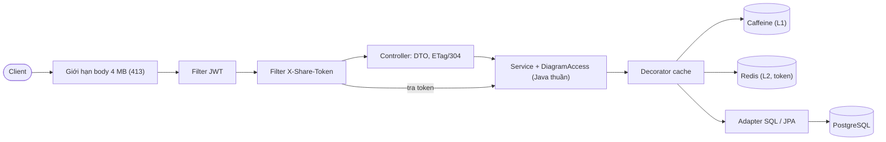

# DiagramIO

[](https://github.com/vietsosad/DiagramIO_16/actions/workflows/ci.yml)

DiagramIO là backend REST API (JSON) cho một web vẽ sơ đồ UML và ERD trực tuyến: quản lý tài khoản, lưu trữ sơ đồ, lịch sử phiên bản và chia sẻ sơ đồ qua link. Đây là bài tập lớn môn Kiến trúc phần mềm, gồm hai pha:

- **Pha 1:** baseline, ưu tiên chạy đúng và đơn giản.
- **Pha 2:** cải tiến kiến trúc theo [kế hoạch pha 2](docs/ke-hoach-pha-2.md). Mỗi cải tiến xuất phát từ số đo của hệ thống, có số đo trước và sau trên cùng một cấu hình Kaggle CPU, và có một ADR ghi lại lý do ([docs/adr/](docs/adr/)). Tiến độ ở [mục 7](#7-pha-2-tiến-độ-và-kết-quả).

| Thành viên | Mã sinh viên | Phụ trách |
|---|---|---|
| Lê Hoàng Việt | 23020169 | Toàn bộ pha 2: phép đo hiệu năng (M0), tối ưu truy cập dữ liệu (B1), cache hai tầng và HTTP conditional request (B2), cache xác thực link chia sẻ (B3), rà soát và gia cố, nhiều instance sau Nginx và tắt máy êm (B4), CI, đóng gói |

Mã nguồn pha 1 (baseline) kế thừa từ repo gốc [Phamminh161005/DiagramIO](https://github.com/Phamminh161005/DiagramIO); repo này là bản fork, nơi thực hiện pha 2.

## 1. Bài toán và phạm vi

Sinh viên công nghệ thường xuyên vẽ sơ đồ UML và ERD khi làm đồ án. Mỗi bản vẽ có cấu trúc riêng, cần lưu lại lịch sử chỉnh sửa và chia sẻ cho người khác xem hoặc cùng sửa. Hệ thống có hai loại người dùng:

- **Khách (chưa đăng nhập):** xem sơ đồ công khai; xem hoặc sửa sơ đồ qua link chia sẻ, tùy quyền của link.
- **Người dùng đã đăng nhập:** tạo, sửa, xóa sơ đồ của mình; lưu và khôi phục phiên bản; tạo và quản lý link chia sẻ.

Bốn đối tượng chính là User (tài khoản), Diagram (tên, loại UML/ERD, dữ liệu JSON gồm `nodes` và `edges`, trạng thái công khai, chủ sở hữu, `version`), Diagram Version (bản chụp cố định của dữ liệu sơ đồ kèm ghi chú) và Diagram Share (link chia sẻ bằng token với quyền `view` hoặc `edit`).

Đã làm:

- **Pha 1:** đăng ký, đăng nhập bằng JWT; quản lý sơ đồ; lịch sử phiên bản và khôi phục; chia sẻ công khai và qua link; chống ghi đè bằng optimistic locking; tài liệu OpenAPI; đóng gói Docker.
- **Pha 2 (tới B4):** bộ đo hiệu năng tái lập được trên Kaggle; truy cập dữ liệu chỉ đọc và ghi đúng phần cần thiết; cache hai tầng (Caffeine, Redis) cho sơ đồ và phiên bản; ETag và 304; cache xác thực link chia sẻ với thu hồi có hiệu lực ngay; giới hạn kích thước request; nhiều instance sau Nginx, probe liveness và readiness, tắt máy êm, khởi động lại cuốn chiếu không rơi request; CI.

Chưa làm hoặc ngoài phạm vi: giao diện frontend và canvas; cộng tác thời gian thực (WebSocket, CRDT); đăng nhập qua bên thứ ba; khôi phục mật khẩu qua email; mẫu sơ đồ. Rate limiting, xuất PNG/SVG/PDF là các phần sau của pha 2 (B5, B6).

## 2. Công nghệ

| Thành phần | Lựa chọn |
|---|---|
| Ngôn ngữ, framework | Java 21, Spring Boot 3.4 (Web, Validation, Security) |
| CSDL | PostgreSQL 16, Flyway quản lý schema; Spring Data JPA cho tài khoản, refresh token, link chia sẻ; SQL viết tay (`NamedParameterJdbcTemplate`) cho sơ đồ và phiên bản |
| Cache | Caffeine trong JVM; Redis 7.4 (client Lettuce) dùng chung khi chạy nhiều bản; ETag và 304 |
| Xác thực | JWT (jjwt), BCrypt, refresh token lưu dạng SHA-256 |
| Đo lường | Spring Boot Actuator, Micrometer Prometheus (cổng quản trị riêng, chỉ localhost); bộ đo k6, async-profiler trên Kaggle CPU (`bench/`) |
| Tài liệu API | springdoc-openapi (Swagger UI), `docs/openapi.yaml` |
| Đóng gói | Docker (image nhiều lớp, chạy bằng user thường), Docker Compose |
| Kiểm thử, CI | JUnit 5, Mockito, MockMvc, Testcontainers (PostgreSQL, Redis), ArchUnit; GitHub Actions |

## 3. Kiến trúc

Ứng dụng chia thành ba tầng. Phụ thuộc chỉ đi theo một chiều: tầng API và tầng truy cập dữ liệu đều phụ thuộc vào tầng nghiệp vụ, còn tầng nghiệp vụ không phụ thuộc vào ai.

| Tầng | Package | Vai trò | Được dùng |
|---|---|---|---|
| API | `api` | Controller, DTO, kiểm tra đầu vào, giới hạn kích thước body, ETag/304, `GlobalExceptionHandler` đổi ngoại lệ nghiệp vụ thành mã HTTP | Spring Web |
| Nghiệp vụ | `domain` | Model, service, interface repository (port), ngoại lệ nghiệp vụ, luật phân quyền | Chỉ Java thuần |
| Truy cập dữ liệu | `infrastructure` | Adapter SQL và JPA cài đặt port của domain, decorator cache, BCrypt, JWT, filter xác thực | Spring Data JPA, JDBC, Caffeine, Spring Data Redis, Spring Security |
| Lắp ghép | `config` | Tạo service của domain bằng `@Bean`, chọn chế độ cache, cấu hình bảo mật, web và OpenAPI | Spring |

Tầng nghiệp vụ không import Spring, JPA, Servlet hay thư viện cache (không có `@Service`, `@Entity`, `@Transactional`). Quy tắc này được `ArchitectureTest` (ArchUnit) kiểm tra mỗi lần chạy test.

Đường đi của một request:



Trong mỗi tầng, code được chia theo tính năng:

```
src/main/java/com/diagramio/
├── api/             auth, user, diagram, version, share (mỗi phần có controller và dto/), dto/ dùng chung,
│                    RequestSizeLimitFilter, ConditionalRequests (ETag), RawJsonSerializer
├── domain/          auth, user, diagram, version, share, access (Caller, DiagramAccess, Permission), exception
├── infrastructure/  auth, user, share (entity JPA, adapter), diagram, version (adapter SQL),
│                    cache (decorator, Caffeine, Redis, bộ theo dõi Redis), security
└── config/          AuthConfig, DiagramConfig, DiagramVersionConfig, ShareConfig, CacheConfig, CacheProperties,
                     SecurityConfig, WebConfig, OpenApiConfig
src/main/resources/db/migration/   V1__create_tables.sql, V2__seed_sample_user.sql, V3__create_refresh_tokens.sql,
                                   V4__phase2_indexes.sql
```

Các điểm thiết kế chính:

- **Xác thực ở filter, không lặp lại ở endpoint.** Filter JWT đọc `Authorization: Bearer <token>`, filter thứ hai đọc `X-Share-Token` của link chia sẻ. Hai filter không tự chặn request; việc trả 401 do `SecurityConfig` quyết định. Controller nhận sẵn tham số `Caller` (khách nếu không đăng nhập, không có link) hoặc `@CurrentUser UUID` (endpoint cần tài khoản).
- **Phân quyền ở một chỗ.** Luật quyền nằm trong `Caller`; service chỉ gọi `DiagramAccess` với mức quyền cần (`VIEW`, `VIEW_HISTORY`, `EDIT`, `MANAGE`), nên mọi module trả cùng mã lỗi 404/401/403. `require` chỉ đọc chủ, cờ công khai và version (không đọc `data`), `requireLocked` thêm khóa dòng cho lưu và khôi phục phiên bản, `requireDiagram` đọc cả sơ đồ khi response trả nội dung.
- **Transaction theo quy tắc, không đặt khắp nơi.** Domain nhận transaction qua port `TransactionRunner` (infrastructure cài bằng `TransactionTemplate`), chỉ dùng khi phải đọc rồi ghi hoặc ghi nhiều bảng: làm mới token, lưu và khôi phục phiên bản. Quy tắc ghi trong `AGENTS.md`.
- **Chống ghi đè** bằng optimistic locking: sửa sơ đồ là một câu `UPDATE ... WHERE version = :expected`, không khớp thì 409. Lưu và khôi phục phiên bản khóa dòng sơ đồ (`SELECT ... FOR UPDATE`) để các yêu cầu đồng thời xếp hàng.
- **Chỉ đọc, ghi đúng phần cần** ([ADR-0002](docs/adr/0002-toi-uu-truy-cap-du-lieu.md)): danh sách và lịch sử là projection không có `data`; snapshot và khôi phục chép `data` ngay trong CSDL (`INSERT ... SELECT`, `UPDATE ... FROM`); danh sách luôn sắp "mới sửa trước" và lấy trang cùng tổng số trong một câu lệnh.
- **Cache hai tầng** ([ADR-0003](docs/adr/0003-cache-hai-tang-etag.md)): decorator của repository; ghi CSDL rồi ghi trạng thái mới vào cache sau commit, chỉ khi version mới hơn; bia mộ khi xóa; nhiều instance thì báo nhau qua Redis pub/sub; Redis lỗi thì đọc thẳng CSDL. `GET` sơ đồ trả `ETag`, client gửi lại trong `If-None-Match` thì nhận 304 (sau khi đã kiểm tra quyền).
- **Cache xác thực link chia sẻ** ([ADR-0004](docs/adr/0004-cache-token-chia-se.md)): khóa là SHA-256 của token; nhiều instance thì chỉ cache trên Redis. Thu hồi và đổi quyền có hiệu lực ngay ở request tiếp theo, mọi instance; không bảo đảm được điều đó (Redis lỗi) thì thao tác trả 503 thay vì có hiệu lực trễ.
- **Dữ liệu sơ đồ là kiểu `DiagramData`** (kiểm tra cấu trúc `nodes`/`edges` và 2 MB khi tạo từ request), loại sơ đồ là enum `DiagramType`. Body request lớn hơn 4 MB bị từ chối (413) trước khi được đọc ([ADR-0005](docs/adr/0005-ra-soat-gia-co-sau-b3.md)).
- **Schema do Flyway quản lý**, Hibernate chỉ kiểm tra schema khớp với entity (`ddl-auto: validate`). CSDL gồm năm bảng: `users`, `refresh_tokens`, `diagrams`, `diagram_versions`, `diagram_shares`.

## 4. Đặc tả API

Mọi endpoint có tiền tố `/api/v1`. Đặc tả đầy đủ (request, response, mã lỗi, header) nằm trong [docs/openapi.yaml](docs/openapi.yaml); khi app đang chạy có thể xem và gọi thử trên Swagger UI tại `http://localhost:8080/swagger-ui.html`. Các luồng xử lý phức tạp được vẽ trong [docs/luong-nghiep-vu.md](docs/luong-nghiep-vu.md).

| Nhóm | Method | Endpoint | Mô tả | Quyền |
|---|---|---|---|---|
| Xác thực | POST | `/auth/register` | Đăng ký tài khoản | Công khai |
| | POST | `/auth/login` | Đăng nhập, nhận access token và refresh token | Công khai |
| | POST | `/auth/refresh-token` | Đổi refresh token lấy cặp token mới | Công khai |
| | POST | `/auth/logout` | Thu hồi refresh token | Đăng nhập |
| | GET | `/users/me` | Thông tin cá nhân | Đăng nhập |
| | PATCH | `/users/me/password` | Đổi mật khẩu, cần mật khẩu cũ | Đăng nhập |
| Sơ đồ | GET | `/diagrams` | Sơ đồ của tôi: lọc theo loại, tìm theo tên, phân trang | Đăng nhập |
| | POST | `/diagrams` | Tạo sơ đồ mới | Đăng nhập |
| | GET | `/diagrams/public` | Danh sách sơ đồ công khai | Công khai |
| | GET | `/diagrams/{id}` | Chi tiết sơ đồ kèm dữ liệu; có `ETag`, nhận `If-None-Match` | Sơ đồ công khai, chủ, hoặc có link |
| | PUT | `/diagrams/{id}` | Cập nhật sơ đồ, kèm `version` | Chủ hoặc link edit |
| | DELETE | `/diagrams/{id}` | Xóa sơ đồ | Chủ |
| Phiên bản | GET | `/diagrams/{id}/versions` | Danh sách phiên bản, mới nhất trước | Chủ hoặc có link |
| | POST | `/diagrams/{id}/versions` | Lưu phiên bản mới kèm ghi chú | Chủ hoặc link edit |
| | GET | `/diagrams/{id}/versions/{version_id}` | Chi tiết một phiên bản (bất biến, client được giữ mãi) | Chủ hoặc có link |
| | POST | `/diagrams/{id}/versions/{version_id}/restore` | Khôi phục về phiên bản đã chọn | Chủ hoặc link edit |
| Chia sẻ | GET | `/diagrams/{id}/shares` | Danh sách link chia sẻ | Chủ |
| | POST | `/diagrams/{id}/shares` | Tạo link quyền `view` hoặc `edit` | Chủ |
| | PATCH | `/diagrams/{id}/shares/{share_id}` | Đổi quyền của link | Chủ |
| | DELETE | `/diagrams/{id}/shares/{share_id}` | Thu hồi link | Chủ |
| | GET | `/shares/{token}` | Mở link chia sẻ: trả sơ đồ và quyền; có `ETag` | Công khai |
| Hệ thống | GET | `/health` | Trạng thái dịch vụ và kết nối CSDL | Công khai |

Có hai cách xác thực. Người dùng đăng nhập gửi `Authorization: Bearer <accessToken>`. Người cầm link chia sẻ gửi `X-Share-Token: <shareToken>` khi gọi các endpoint `/diagrams/{id}...`, không cần đăng nhập. Gửi cả hai thì được gộp quyền.

Các quy tắc nghiệp vụ chính:

- Mật khẩu băm bằng BCrypt. Access token có hạn 15 phút. Refresh token có hạn 7 ngày, chỉ dùng được một lần và DB chỉ lưu bản băm. Sai email hay sai mật khẩu đều trả cùng một thông báo.
- Sơ đồ mới luôn ở chế độ riêng tư, dữ liệu khởi tạo là `{"nodes": [], "edges": []}`, loại chỉ nhận `UML` hoặc `ERD`.
- Khi cập nhật, client gửi `version` đang thấy. Lệch với CSDL thì trả 409 và dữ liệu giữ nguyên; khớp thì `version` tăng thêm 1. Trường `data` phải là object có mảng `nodes` và `edges`, tối đa 2 MB. Chỉ chủ được đổi `isPublic`.
- `GET /diagrams/{id}` trả `ETag: W/"<version>"` và `Cache-Control: no-cache, private`; gửi lại ETag đó trong `If-None-Match` thì nhận 304 không có body nếu chưa ai sửa. Người không có quyền vẫn nhận 401/403/404, không bao giờ nhận 304. `GET /shares/{token}` dùng ETag `W/"<version>-<role>"`.
- Phiên bản đã lưu không sửa được (`Cache-Control: private, max-age=31536000, immutable`). Khi khôi phục, hệ thống tự lưu một phiên bản sao lưu trạng thái hiện tại rồi mới chép dữ liệu cũ vào, cả hai bước trong một transaction.
- Danh sách sơ đồ luôn sắp "mới sửa trước" (`updatedAt` giảm dần, rồi theo `id`), nên thứ tự giữa các trang ổn định.
- Chỉ chủ quản lý được link chia sẻ. Link `view` cho xem sơ đồ và lịch sử; link `edit` cho sửa thêm sơ đồ, lưu và khôi phục phiên bản. Link bị thu hồi hoặc bị đổi quyền thì thay đổi có hiệu lực ngay từ request tiếp theo; mở lại link đã thu hồi nhận 404.

Mọi lỗi trả cùng một khung JSON:

```json
{ "timestamp": "2026-10-28T07:30:00Z", "status": 409, "error": "Conflict",
  "message": "Diagram version conflict: requested 1, current 2", "path": "/api/v1/diagrams/..." }
```

| Mã | Khi nào |
|---|---|
| 304 | Không phải lỗi: sơ đồ chưa đổi so với `If-None-Match` (không có body) |
| 400 | Thiếu trường, sai định dạng, `title` dài hơn 255 ký tự, `data` sai cấu trúc hoặc quá 2 MB, `size` lớn hơn 100, mật khẩu cũ sai |
| 401 | Chưa xác thực, token sai hoặc hết hạn, sai email hoặc mật khẩu; chỉ cầm `X-Share-Token` khi gọi endpoint cần tài khoản (`/users/me`, đăng xuất, sơ đồ của tôi, quản lý link); bị từ chối trên một sơ đồ khi không có tài khoản lẫn link của sơ đồ đó (ví dụ khách mở sơ đồ riêng tư) |
| 403 | Đã biết người gọi (có tài khoản, hoặc có link của chính sơ đồ đó) nhưng không đủ quyền với sơ đồ |
| 404 | Không tìm thấy sơ đồ, phiên bản, link, đường dẫn; token chia sẻ đã bị thu hồi |
| 405 | Sai method HTTP (header `Allow` liệt kê method hợp lệ) |
| 409 | Lệch `version` khi cập nhật hoặc lưu phiên bản; email hay username đã tồn tại |
| 413 | Body request lớn hơn 4 MB (bị từ chối trước khi đọc) |
| 415 | Sai `Content-Type` (API nhận `application/json`) |
| 503 | `/health` khi mất kết nối CSDL; đổi quyền hoặc thu hồi link khi cache dùng chung (Redis) không phản hồi, kèm `Retry-After` |

## 5. Cách chạy

Chỉ cần Docker để chạy toàn bộ hệ thống. Muốn chạy app từ IDE hoặc chạy test thì cần thêm JDK 21.

Chạy toàn bộ bằng Docker:

```bash
cp .env.example .env            # đổi mật khẩu, JWT_SECRET, cổng nếu cần
docker compose up -d --build    # build image app, chạy PostgreSQL, Redis và app
```

App chạy ở `http://localhost:8080` (đổi bằng `APP_PORT`). Flyway tự tạo bảng và tài khoản mẫu `uet@gmail.com` / `uet123456` ở lần chạy đầu. Container app có healthcheck gọi `/api/v1/health`. Image chạy bằng user thường, tách lớp thư viện khỏi lớp mã (sửa code chỉ đổi lớp mã), và JVM tự đặt heap bằng 75% RAM của container.

CSDL dùng PostgreSQL 16 (cùng phiên bản với máy đo Kaggle). Volume tạo bởi bản 15 trước đây không mở được bằng bản 16: xóa volume dev bằng `docker compose down -v` (mất dữ liệu dev) hoặc `pg_dump` trước rồi nạp lại.

Chạy app từ IDE khi đang phát triển: chạy riêng CSDL bằng `docker compose up -d postgres`, rồi chạy `DiagramioApplication` (hoặc `./mvnw spring-boot:run`). App tự đọc file `.env`, nên `SPRING_DATASOURCE_URL` phải trỏ đúng cổng `POSTGRES_PORT`. Hai cách chạy dùng chung cổng 8080, không chạy cùng lúc. Chế độ cache mặc định (`local`) không cần Redis.

Số liệu cho việc đo hiệu năng (Spring Boot Actuator) nằm trên cổng quản trị riêng, chỉ nghe `127.0.0.1`: `http://127.0.0.1:9090/actuator/prometheus` và `/actuator/health` (đổi cổng bằng `MANAGEMENT_PORT`). Cổng API không có endpoint Actuator nào; trong container, cổng quản trị không mở ra ngoài.

| Biến trong `.env` | Ý nghĩa |
|---|---|
| `POSTGRES_USER`, `POSTGRES_PASSWORD`, `POSTGRES_DB` | Tài khoản và tên CSDL; mật khẩu chỉ có tác dụng ở lần đầu tạo volume |
| `POSTGRES_PORT`, `APP_PORT` | Cổng mở ra máy cho CSDL và app |
| `SPRING_DATASOURCE_*` | Kết nối CSDL khi chạy app từ IDE |
| `JWT_SECRET` | Khóa ký JWT, ít nhất 32 ký tự; bắt buộc đổi khi triển khai thật |
| `DIAGRAMIO_CACHE_MODE` | Cache: `none`, `local` (mặc định, không cần Redis), `redis`, `two-level` (Caffeine + Redis, khi chạy nhiều bản) |
| `DIAGRAMIO_CACHE_SHARE_TOKENS` | `true` (mặc định) hoặc `false`: bật/tắt cache tra cứu token link chia sẻ |
| `REDIS_PORT` | Cổng mở ra máy cho Redis (chỉ dùng ở chế độ `redis`, `two-level`) |
| `DIAGRAMIO_HTTP_MAX_REQUEST_SIZE` | Body request lớn nhất (mặc định `4MB`); lớn hơn thì 413, không đọc |
| `JAVA_TOOL_OPTIONS` | Cờ JVM trong container; image đặt sẵn `-XX:MaxRAMPercentage=75 -XX:+ExitOnOutOfMemoryError` |
| `SHUTDOWN_TIMEOUT` | Thời gian tối đa để phục vụ nốt request đang chạy khi app nhận SIGTERM (mặc định `20s`) |
| `APP_POOL_SIZE`, `APP_MEMORY` | Chỉ với `docker-compose.scale.yml`: số kết nối CSDL và RAM của mỗi instance (mặc định 4 và `1g`) |

Chạy nhiều instance sau Nginx (B4, [ADR-0006](docs/adr/0006-mo-rong-ngang-san-sang.md)):

```bash
docker compose -f docker-compose.yml -f docker-compose.scale.yml up -d --build --scale app=3
bash deploy/rolling-restart.sh   # khởi động lại lần lượt từng instance, không rơi request nào
```

- Nginx nhận ở `APP_PORT` và chia tải cho các instance (`least_conn`); instance không mở cổng nào ra máy. Nhiều instance thì cache chạy chế độ `two-level` (file override đặt sẵn). Tổng số kết nối CSDL không tăng theo số instance: đặt `APP_POOL_SIZE` bằng tổng chia số instance.
- Mỗi instance có probe `liveness` và `readiness` (`/actuator/health/liveness`, `/actuator/health/readiness` trên cổng quản trị, chỉ trong container). Healthcheck của Docker dùng readiness, nên Nginx chỉ khởi động khi các instance đã sẵn sàng.
- Nhận SIGTERM, instance báo không sẵn sàng, thôi nhận kết nối mới, phục vụ nốt request đang chạy (tối đa `SHUTDOWN_TIMEOUT`) rồi mới tắt.
- `rolling-restart.sh`: với từng instance, Nginx thôi gửi tới nó, chờ request dở xong, Docker tắt êm rồi bật lại, chờ readiness, rồi Nginx gửi lại. Script chỉ khởi động lại container đang chạy; Docker Compose không có cập nhật cuốn chiếu sang image mới (ADR-0006).
- Một instance chết đột ngột: Nginx chuyển GET, PUT, DELETE sang instance khác; POST, PATCH đã gửi tới instance đó thì client nhận 502, không gửi lại để tránh tạo trùng.

Thử nhanh bằng `curl`:

```bash
TOKEN=$(curl -s -X POST localhost:8080/api/v1/auth/login -H "Content-Type: application/json" \
  -d '{"email":"uet@gmail.com","password":"uet123456"}' | jq -r .accessToken)
curl -s -X POST localhost:8080/api/v1/diagrams -H "Authorization: Bearer $TOKEN" \
  -H "Content-Type: application/json" -d '{"title":"Shop ERD","diagramType":"ERD"}'
```

Kiểm thử:

- **CI** (GitHub Actions, `.github/workflows/ci.yml`) chạy ở mỗi pull request và mỗi lần đẩy lên `main`: toàn bộ test, `shellcheck` và kiểm tra cú pháp các script bộ đo và triển khai, kiểm tra `docker-compose.yml` và `docker-compose.scale.yml`, `nginx -t` cho cấu hình Nginx, build image.
- **Chạy test ở máy:** `./mvnw test` (cần Docker đang chạy). Có ba nhóm:
  - Unit test và test controller (MockMvc): chạy được ở mọi máy.
  - Test CSDL và Redis trong `infrastructure` (Testcontainers): không có Docker thì tự bỏ qua. Gồm cả các tình huống tranh chấp (lần đọc chậm không được đè bản mới, token đã thu hồi không được sống lại trong cache) và Redis bị treo giữa chừng (`docker pause`).
  - Test E2E hộp đen trong `src/test/java/com/diagramio/e2e`: khởi động cả app trên cổng ngẫu nhiên với PostgreSQL thật và chỉ gọi API qua HTTP, kiểm tra mọi endpoint với từng vai trò (chủ, link edit, link view, người khác, khách). Nhóm này cố ý báo lỗi khi không có Docker để không "xanh giả". Chạy riêng: `./mvnw test -Dtest='com.diagramio.e2e.**'`; bỏ qua: `./mvnw test -Dtest='!com.diagramio.e2e.**'`.
- Một số test E2E đáng chú ý:
  - `SqlPerRequestE2eTest` đếm câu SQL, transaction và số lần chở `data` của từng endpoint (cache tắt), ghi bảng ra `target/bench/sql-per-request.md`; thay đổi làm đổi các con số này thì sửa con số trong test cùng PR.
  - `CacheE2eTest`, `ShareTokenCacheE2eTest`: ETag, 304, cache sơ đồ và cache token (đọc qua link khi trúng cache không tốn câu SQL nào).
  - `TwoInstanceCacheE2eTest`: hai bản app thật dùng chung PostgreSQL và Redis; sửa, xóa, thu hồi link ở bản này thì bản kia thấy.
  - `RequestLimitsE2eTest`, `RedisDownAtStartupE2eTest`: giới hạn body (413) và app khởi động được khi Redis chưa lên.
  - `GracefulShutdownE2eTest`, `NginxFailoverE2eTest`: tắt êm (request đang chạy vẫn xong, readiness báo từ chối trước khi cổng đóng) và Nginx thật trước hai instance thật (Nginx thôi gửi tới một instance rồi instance đó tắt giữa lúc có tải mà không request nào lỗi; hết instance thì Nginx trả 502 theo khung JSON của API).
- Dùng JDK mới hơn 21 (ví dụ 25) thì thêm `-DargLine="-Dnet.bytebuddy.experimental=true"` để Mockito chạy được.

Việc thường làm khác:

- Xuất lại đặc tả API sau khi đổi endpoint (app đang chạy): `curl -o docs/openapi.yaml http://localhost:8080/v3/api-docs.yaml`. Khóa được sắp xếp cố định và server là URL tương đối, nên file chỉ thay đổi khi API thay đổi.
- Thay đổi CSDL: thêm file migration mới dạng `V<số>__mo_ta.sql` (hai dấu gạch dưới) trong `src/main/resources/db/migration`, không sửa các file đã có.
- Quy tắc kiến trúc, transaction, cache và kiểm thử cho người (và công cụ AI) sửa code: [AGENTS.md](AGENTS.md).

## 6. Đo hiệu năng

Pha 2 đo bằng bộ đo trong [bench/](bench/README.md), chạy lại được từ một notebook Kaggle trắng; phương pháp và lý do của từng lựa chọn ở [ADR-0001](docs/adr/0001-phuong-phap-do.md):

- Kaggle Notebook CPU (4 vCPU): 3 vCPU cho hệ thống được đo (app, PostgreSQL, Redis), 1 vCPU cho máy tạo tải k6.
- Dữ liệu sinh xác định: 2.000 user, 50.000 sơ đồ (2% là sơ đồ 0,5-1,5 MB), khoảng 150.000 phiên bản, 20.000 link; mỗi lần đo chép lại CSDL mẫu.
- Kịch bản: W1 (chuỗi 6 request của pha 1), W2 (85% đọc, 15% ghi, sơ đồ "nóng" theo phân bố Zipf), W3 (như W2 trên sơ đồ lớn). Mô hình tải mở (tốc độ đến cố định) cho độ trễ, tăng dần từng bậc để tìm sức chứa (throughput lớn nhất còn giữ p95 ≤ 100 ms, lỗi < 1%).
- Mỗi phép đo lặp nhiều lần, các cấu hình chạy xen kẽ trong cùng một phiên; báo cáo kèm CPU từng tiến trình, câu SQL tốn thời gian nhất, tỉ lệ trúng cache, flame graph.

Mốc C0 (mã pha 1 cộng phần đo, tag `v2.0-m0`), đo trên Kaggle (AMD EPYC 7B12), chi tiết ở [danh-gia-hien-trang.md](docs/pha-2/danh-gia-hien-trang.md):

| Kịch bản | Chỉ số | C0 |
|---|---|---|
| W2 | Sức chứa đạt SLO | 300 req/s (300–400) |
| W2 | p95 ở 200 req/s | 31,6 ms |
| W3 | Sức chứa đạt SLO | 10 req/s (10–30) |
| W3 | p95 ở 20 req/s | 90,9 ms |
| W1 | Throughput, p95 ở 10 VU | 1.503 req/s, 10,8 ms |
| CSDL | SQL mỗi request (W1 / W2 / W3) | 3,33 / 2,15 / 2,13 |

Nút thắt của C0: W2 bị giới hạn bởi PostgreSQL (đếm sơ đồ công khai bằng quét tuần tự chiếm 46% thời gian CSDL), W3 bởi việc đọc và trả `data` lớn (83% CPU của app nằm trong việc ghi chuỗi JSON). B1–B3 nhắm đúng các điểm này.

Các cấu hình so sánh (mỗi cấu hình là một tag, cấu hình bật/tắt bằng cờ dùng chung một tag):

| Cấu hình | Tag | Nội dung | Ma trận đo |
|---|---|---|---|
| C0 | `v2.0-m0` | Mã pha 1 cộng phần đo | `m0`, `b12` |
| C1 | `v2.1-b1` | C0 + B1 | `b12` |
| C2, C3 | `v2.2-b2` | C1 + B2, cache `local` (C2) hoặc `two-level` (C3) | `b12` |
| C2, C3 và C2b3, C3b3 | `v2.3.2` | Cùng một jar (B3, gia cố sau B3, bản sửa cache sau phiên `b12`), cache token tắt (C2, C3) hoặc bật (C2b3, C3b3) | `b3` |
| C3, C4x1, C4x2, C4x3 | `v2.4-b4` | B4: một app (C3) so với 1, 2, 3 instance sau Nginx, cùng tổng heap và tổng số kết nối CSDL | `b4` |

Kết quả B1, B2 (phiên `b12`, Kaggle Intel Xeon 2,20 GHz, khác máy của phiên M0 nên C0 cũng khác; chỉ so trong cùng phiên), chi tiết ở [docs/pha-2/ket-qua.md](docs/pha-2/ket-qua.md):

| Kịch bản | Chỉ số | C0 | C1 (B1) | C2 (B2, cache trong JVM) |
|---|---|---|---|---|
| W2 | Sức chứa đạt SLO | 200 req/s | **800 req/s** | ≥ 800 req/s (k6 là nút thắt) |
| W2 | p95 ở 200 req/s | 100,8 ms | **9,0 ms** | 8,9 ms |
| W2 | CPU PostgreSQL ở 400 req/s, trạng thái gần ổn định | quá tải | 0,61 nhân | **0,50 nhân** |
| W3 | Tốc độ còn phục vụ kịp | 30 req/s | 70 req/s | **110-130 req/s** |
| W3 | p50 ở 20 req/s | 110 ms | 19,2 ms | **5,2 ms** |
| W1 | Throughput (50 VU) | 832 req/s | **1.191 req/s** | 1.156 req/s |
| CSDL | SQL mỗi request (W2 / W3) | 2,15 / 2,19 | 1,49 / 1,52 | **0,87 / 0,91** |

Phiên này cũng phát hiện hai lỗi của cache B2 khi Redis hết thời gian chờ: cache trả bản cũ, và PUT đúng version nhận 409. Cả hai đã sửa ([ADR-0003](docs/adr/0003-cache-hai-tang-etag.md) mục 8).

Kết quả B3 và đo lại C2, C3 (phiên `b3`, [ket-qua.md](docs/pha-2/ket-qua.md) mục 7):

- Bản sửa cache đứng vững: không có lần 409 nào trong 28 lần chạy, dù Redis vẫn hết thời gian chờ lúc warm-up. 304 tăng từ 0,3% lên 2,5-3,0% số request.
- Cache token bớt 19-20% số câu SQL và 21-22% số transaction mỗi request của W2, trúng 80%. Ở một instance, p50 của request qua link giảm từ 2,0 xuống 1,1 ms. Sức chứa không đổi (700-750 req/s ở cả bốn cấu hình, sát giới hạn của k6). Chênh lệch CPU app không tách được khỏi nhiễu của máy ảo trong phiên này.
- Mức 700 req/s cố định không đo được vì JVM nguội nhận ngay toàn bộ tải; bộ đo đã thêm warm-up tăng dần (`WARMUP_RAMP`).

Số đo pha 1 (Locust trên Kaggle, commit `ca41f27`) được giữ trong [docs/pha-1/kiem-thu-tai-locust.md](docs/pha-1/kiem-thu-tai-locust.md) để tham khảo. Không so trực tiếp với pha 2: Locust, app và CSDL dùng chung CPU, kịch bản 100% ghi trên CSDL gần rỗng. Cùng chuỗi request ở 10 người dùng, Locust chỉ đẩy được 330 req/s còn k6 đẩy được 1.503 req/s, tức là số pha 1 chủ yếu đo giới hạn của công cụ tạo tải.

| Mức tải (pha 1) | Tổng RPS | p95 | p99 | Lỗi |
|---|---|---|---|---|
| 10 user | 329,78 | 7 ms | 9 ms | 0% |
| 50 user | 736,22 | 46 ms | 56 ms | 0% |
| 100 user | 747,49 | 110 ms | 130 ms | 0% |

## 7. Pha 2: tiến độ và kết quả

Kế hoạch chi tiết: [docs/ke-hoach-pha-2.md](docs/ke-hoach-pha-2.md).

| Phần | Bài toán | Trạng thái | ADR |
|---|---|---|---|
| M0 | Dựng lại phép đo (phép đo pha 1 đo giới hạn của Locust) | Xong, đã đo C0 | [0001](docs/adr/0001-phuong-phap-do.md) |
| B1 | Mỗi request chạy thừa SQL và chở `data` (tới 2 MB) không cần thiết | Xong, đã đo: sức chứa W2 gấp 4 | [0002](docs/adr/0002-toi-uu-truy-cap-du-lieu.md) |
| B2 | Đường đọc sơ đồ luôn chạm CSDL; client mở lại vẫn nhận lại toàn bộ nội dung | Xong, đã đo; sửa 2 lỗi phiên đo phát hiện, đo lại ở `b3`: không còn 409 sai | [0003](docs/adr/0003-cache-hai-tang-etag.md) |
| B3 | Mọi request có `X-Share-Token` đều tra CSDL, trong khi thu hồi phải có hiệu lực ngay | Xong, đã đo: SQL mỗi request của W2 −20% | [0004](docs/adr/0004-cache-token-chia-se.md) |
| Rà soát | Gia cố sau B3: giới hạn body, khởi động khi Redis chết, bộ nhớ cache, CI, image | Xong | [0005](docs/adr/0005-ra-soat-gia-co-sau-b3.md) |
| B4 | Chạy nhiều instance sau Nginx, tắt máy êm, sẵn sàng khi một instance chết | Xong, chờ số đo Kaggle (`b4`) | [0006](docs/adr/0006-mo-rong-ngang-san-sang.md) |
| B5 | Rate limiting, bulkhead cho đăng nhập, phát hiện refresh token bị dùng lại | Chưa làm | |
| B6 | Xuất PNG/SVG/PDF qua hàng đợi và worker riêng | Chưa làm | |
| B7 | Lưu phiên bản hiệu quả (khử trùng lặp, nén) | Chưa làm | |
| B8 | Cộng tác thời gian thực theo thao tác (tùy chọn) | Chưa làm | |

Kết quả không phụ thuộc phần cứng (đo bằng test, sơ đồ 50 KB):

| Endpoint | Trước (C0): SQL / lần chở `data` | Sau |
|---|---|---|
| `PUT /diagrams/{id}` | 3 / 3 | 2 / 1 |
| `POST /diagrams/{id}/versions` | 4 / 2 | 2 / 1 |
| `POST .../versions/{vid}/restore` | 6 / 4 | 4 / 1 |
| `GET /diagrams`, tìm theo tên (trang 20 sơ đồ) | 4 / 21 | 1 / 0 |
| `GET /diagrams/{id}/versions` (10 phiên bản) | 2 / 11 | 2 / 0 |
| `POST`, `PATCH`, `DELETE` link chia sẻ | 4 / 3 / 4 câu | 2 / 2 / 2 câu |
| `GET /diagrams/{id}` kèm `X-Share-Token`, `GET /shares/{token}` | 2 câu | 0 câu khi trúng cache |
| `GET /diagrams/{id}` mở lại, sơ đồ chưa đổi | Gửi lại toàn bộ `data` | 304, không có body |

## 8. Tài liệu liên quan

- [docs/openapi.yaml](docs/openapi.yaml): đặc tả API dạng OpenAPI 3.1. Xem trực quan bằng cách mở file trong [Swagger Editor](https://editor.swagger.io) (File, Import file) hoặc extension OpenAPI của VS Code.
- [docs/luong-nghiep-vu.md](docs/luong-nghiep-vu.md): flowchart các luồng xác thực, phân quyền, cập nhật sơ đồ, phiên bản và chia sẻ.
- [docs/ke-hoach-pha-2.md](docs/ke-hoach-pha-2.md): kế hoạch pha 2; [docs/pha-2/danh-gia-hien-trang.md](docs/pha-2/danh-gia-hien-trang.md): đánh giá hiện trạng và số đo C0.
- [docs/adr/](docs/adr/): ADR-0001 (phương pháp đo), ADR-0002 (truy cập dữ liệu), ADR-0003 (cache hai tầng, ETag), ADR-0004 (cache token chia sẻ), ADR-0005 (rà soát và gia cố).
- [bench/README.md](bench/README.md): cách chạy bộ đo trên Kaggle và trên máy.
- [docs/pha-1/kiem-thu-tai-locust.md](docs/pha-1/kiem-thu-tai-locust.md): số đo pha 1.
- [AGENTS.md](AGENTS.md): quy tắc kiến trúc, transaction, cache, bảo mật và kiểm thử của dự án.
