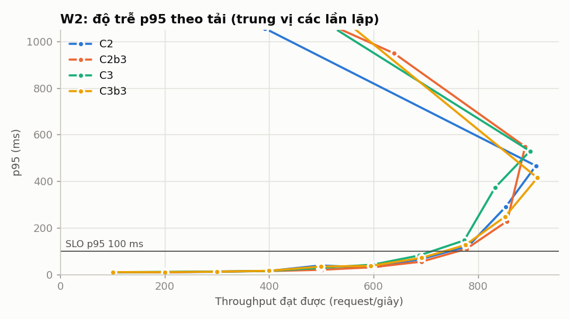
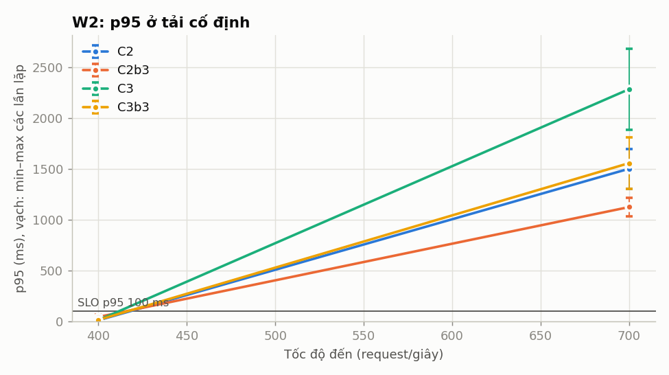
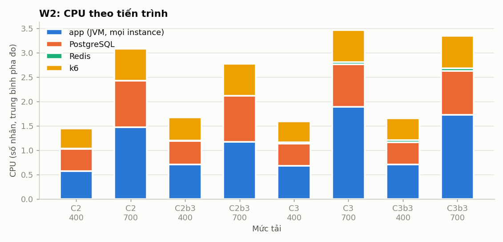
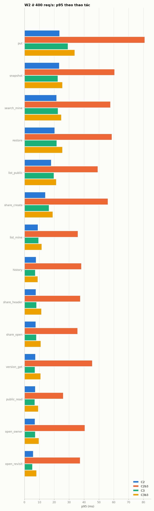

# Kết quả đo: 20261127-152353-b3

Sinh tự động bởi `bench/analysis/report.py`. Phương pháp: [ADR-0001](../../../docs/adr/0001-phuong-phap-do.md), cách chạy lại: [bench/README.md](../../README.md).

## Môi trường

- Máy: Intel(R) Xeon(R) CPU @ 2.20GHz, 4 vCPU (2 luồng/nhân), RAM 31Gi
- Hệ điều hành: Ubuntu 24.04.5 LTS
- Bố trí CPU: hệ thống được đo 0,1,2, tạo tải 3
- Phần mềm: openjdk version "21.0.13.1" 2026-11-17 LTS; k6 v2.3.0; PostgreSQL 16.16
- Cấu hình C2: `v2.3.2` (commit `50683e5d15`), tham số `--diagramio.cache.mode=local --diagramio.cache.share-tokens=false`
- Cấu hình C2b3: `HEAD` (commit `50683e5d15`), tham số `--diagramio.cache.mode=local`
- Cấu hình C3: `v2.3.2` (commit `50683e5d15`), tham số `--diagramio.cache.mode=two-level --diagramio.cache.share-tokens=false`
- Cấu hình C3b3: `HEAD` (commit `50683e5d15`), tham số `--diagramio.cache.mode=two-level`
- Dữ liệu: scale 1.0, seed 20261123: 2000 user, 50000 sơ đồ (1582 MB data), 148345 phiên bản, 20000 link

## Kiểm tra tính hợp lệ của phép đo

| Lần chạy | Vấn đề |
|---|---|
| `C2_w2_capacityauto_r2` | k6 dùng tới 0.83 CPU (> 0.8): máy tạo tải có thể là nút thắt |
| `C2_w2_fixed400_r2` | 1230 iteration bị bỏ (thiếu VU sẵn sàng) |
| `C2_w2_fixed400_rprof` | 1152 iteration bị bỏ (thiếu VU sẵn sàng) |
| `C2_w2_fixed700_r1` | k6 dùng tới 0.88 CPU (> 0.8): máy tạo tải có thể là nút thắt; 28807 iteration bị bỏ (thiếu VU sẵn sàng); CPU app ở phần ba đầu pha đo cao hơn phần ba cuối 91%: JVM chưa ấm hết sau warm-up (tăng WARMUP) |
| `C2_w2_fixed700_r2` | k6 dùng tới 0.84 CPU (> 0.8): máy tạo tải có thể là nút thắt; 17380 iteration bị bỏ (thiếu VU sẵn sàng); CPU app ở phần ba đầu pha đo cao hơn phần ba cuối 90%: JVM chưa ấm hết sau warm-up (tăng WARMUP) |
| `C2b3_w2_capacityauto_r1` | k6 dùng tới 0.88 CPU (> 0.8): máy tạo tải có thể là nút thắt |
| `C2b3_w2_capacityauto_r2` | k6 dùng tới 0.86 CPU (> 0.8): máy tạo tải có thể là nút thắt |
| `C2b3_w2_fixed400_r2` | 731 iteration bị bỏ (thiếu VU sẵn sàng); CPU app ở phần ba đầu pha đo cao hơn phần ba cuối 34%: JVM chưa ấm hết sau warm-up (tăng WARMUP) |
| `C2b3_w2_fixed400_rprof` | 1252 iteration bị bỏ (thiếu VU sẵn sàng) |
| `C2b3_w2_fixed700_r1` | k6 dùng tới 0.86 CPU (> 0.8): máy tạo tải có thể là nút thắt; 19045 iteration bị bỏ (thiếu VU sẵn sàng); CPU app ở phần ba đầu pha đo cao hơn phần ba cuối 100%: JVM chưa ấm hết sau warm-up (tăng WARMUP) |
| `C2b3_w2_fixed700_r2` | k6 dùng tới 0.86 CPU (> 0.8): máy tạo tải có thể là nút thắt; 13427 iteration bị bỏ (thiếu VU sẵn sàng); CPU app ở phần ba đầu pha đo cao hơn phần ba cuối 56%: JVM chưa ấm hết sau warm-up (tăng WARMUP) |
| `C3_w2_capacityauto_r1` | k6 dùng tới 0.85 CPU (> 0.8): máy tạo tải có thể là nút thắt |
| `C3_w2_capacityauto_r2` | k6 dùng tới 0.86 CPU (> 0.8): máy tạo tải có thể là nút thắt |
| `C3_w2_fixed400_r1` | 1330 iteration bị bỏ (thiếu VU sẵn sàng); 159 lệnh Redis (L2) lỗi trong lần chạy, 0 trong pha đo |
| `C3_w2_fixed400_r2` | 1597 iteration bị bỏ (thiếu VU sẵn sàng); 144 lệnh Redis (L2) lỗi trong lần chạy, 0 trong pha đo |
| `C3_w2_fixed400_rprof` | 1115 iteration bị bỏ (thiếu VU sẵn sàng); 83 lệnh Redis (L2) lỗi trong lần chạy, 0 trong pha đo |
| `C3_w2_fixed700_r1` | k6 dùng tới 0.95 CPU (> 0.8): máy tạo tải có thể là nút thắt; vượt sức chứa: chỉ đạt 622/700 req/s; 193 lệnh Redis (L2) lỗi trong lần chạy, 8 trong pha đo |
| `C3_w2_fixed700_r2` | k6 dùng tới 0.89 CPU (> 0.8): máy tạo tải có thể là nút thắt; 38880 iteration bị bỏ (thiếu VU sẵn sàng); CPU app ở phần ba đầu pha đo cao hơn phần ba cuối 31%: JVM chưa ấm hết sau warm-up (tăng WARMUP); 151 lệnh Redis (L2) lỗi trong lần chạy, 5 trong pha đo |
| `C3b3_w2_capacityauto_r1` | k6 dùng tới 0.81 CPU (> 0.8): máy tạo tải có thể là nút thắt |
| `C3b3_w2_capacityauto_r2` | k6 dùng tới 0.85 CPU (> 0.8): máy tạo tải có thể là nút thắt |
| `C3b3_w2_fixed400_r1` | 2133 iteration bị bỏ (thiếu VU sẵn sàng); 268 lệnh Redis (L2) lỗi trong lần chạy, 0 trong pha đo |
| `C3b3_w2_fixed400_r2` | 769 iteration bị bỏ (thiếu VU sẵn sàng); 123 lệnh Redis (L2) lỗi trong lần chạy, 0 trong pha đo |
| `C3b3_w2_fixed400_rprof` | 1784 iteration bị bỏ (thiếu VU sẵn sàng); 71 lệnh Redis (L2) lỗi trong lần chạy, 0 trong pha đo |
| `C3b3_w2_fixed700_r1` | k6 dùng tới 0.85 CPU (> 0.8): máy tạo tải có thể là nút thắt; 20434 iteration bị bỏ (thiếu VU sẵn sàng); CPU app ở phần ba đầu pha đo cao hơn phần ba cuối 74%: JVM chưa ấm hết sau warm-up (tăng WARMUP); 139 lệnh Redis (L2) lỗi trong lần chạy, 0 trong pha đo |
| `C3b3_w2_fixed700_r2` | k6 dùng tới 0.89 CPU (> 0.8): máy tạo tải có thể là nút thắt; 38123 iteration bị bỏ (thiếu VU sẵn sàng); CPU app ở phần ba đầu pha đo cao hơn phần ba cuối 27%: JVM chưa ấm hết sau warm-up (tăng WARMUP); 125 lệnh Redis (L2) lỗi trong lần chạy, 1 trong pha đo |

## W2

### Sức chứa: throughput tối đa còn giữ p95 ≤ 100 ms, lỗi < 1%

| Cấu hình | Tốc độ tối đa đạt SLO (req/s) | Số lần lặp |
|---|---|---|
| C2 | 700 | 2 |
| C2b3 | 700 | 2 |
| C3 | 700 | 2 |
| C3b3 | 750 (700–800) | 2 |

Từng bậc tải (lần lặp đầu):

| Cấu hình | Mục tiêu | Đạt | p95 (ms) | p99 (ms) | Lỗi | CPU app | CPU PostgreSQL |
|---|---|---|---|---|---|---|---|
| C2 | 100 | 100 | 7.8 | 10.9 | 0.00% | 0.23 | 0.08 |
| C2 | 200 | 200 | 9.5 | 15.4 | 0.00% | 0.52 | 0.21 |
| C2 | 300 | 300 | 10.9 | 27.0 | 0.00% | 0.66 | 0.34 |
| C2 | 400 | 400 | 13.5 | 44.9 | 0.00% | 0.68 | 0.46 |
| C2 | 500 | 499 | 29.6 | 70.8 | 0.00% | 0.82 | 0.65 |
| C2 | 600 | 599 | 37.4 | 82.1 | 0.00% | 0.95 | 0.65 |
| C2 | 700 | 689 | 64.5 | 113.8 | 0.00% | 0.90 | 0.81 |
| C2 | 800 ✗ | 781 | 117.6 | 177.5 | 0.00% | 1.03 | 0.74 |
| C2 | 900 ✗ | 857 | 264.2 | 341.4 | 0.00% | 1.05 | 1.05 |
| C2 | 1000 ✗ | 906 | 485.4 | 570.1 | 0.00% | 1.12 | 1.04 |
| C2 | 1100 ✗ | 65 | 1084.1 | 1375.2 | 0.00% | 0.98 | 1.23 |
| C2b3 | 100 | 100 | 9.1 | 14.2 | 0.00% | 0.26 | 0.10 |
| C2b3 | 200 | 200 | 8.3 | 14.1 | 0.00% | 0.38 | 0.18 |
| C2b3 | 300 | 300 | 10.9 | 30.5 | 0.00% | 0.57 | 0.29 |
| C2b3 | 400 | 400 | 15.8 | 43.1 | 0.00% | 0.80 | 0.47 |
| C2b3 | 500 | 500 | 17.7 | 49.4 | 0.00% | 0.75 | 0.54 |
| C2b3 | 600 | 597 | 34.0 | 81.5 | 0.00% | 0.92 | 0.60 |
| C2b3 | 700 | 694 | 44.5 | 97.1 | 0.00% | 0.90 | 0.76 |
| C2b3 | 800 ✗ | 781 | 100.1 | 164.7 | 0.00% | 1.05 | 0.75 |
| C2b3 | 900 ✗ | 862 | 207.3 | 289.3 | 0.00% | 1.01 | 0.90 |
| C2b3 | 1000 ✗ | 896 | 545.2 | 813.3 | 0.00% | 1.08 | 1.03 |
| C2b3 | 1100 ✗ | 949 | 886.3 | 1021.5 | 0.00% | 1.11 | 1.24 |
| C2b3 | 1200 ✗ | 186 | 1404.3 | 1710.6 | 0.00% | 1.27 | 0.74 |
| C3 | 100 | 100 | 9.7 | 13.4 | 0.00% | 0.33 | 0.09 |
| C3 | 200 | 200 | 10.0 | 21.8 | 0.00% | 0.54 | 0.21 |
| C3 | 300 | 300 | 12.2 | 29.7 | 0.00% | 0.74 | 0.34 |
| C3 | 400 | 400 | 14.6 | 36.9 | 0.00% | 0.72 | 0.44 |
| C3 | 500 | 500 | 23.2 | 56.7 | 0.00% | 0.86 | 0.59 |
| C3 | 600 | 597 | 47.0 | 90.2 | 0.00% | 1.04 | 0.61 |
| C3 | 700 | 686 | 78.3 | 138.6 | 0.00% | 1.01 | 0.78 |
| C3 | 800 ✗ | 773 | 149.0 | 232.5 | 0.00% | 1.16 | 1.03 |
| C3 | 900 ✗ | 814 | 474.0 | 870.4 | 0.00% | 1.27 | 1.27 |
| C3 | 1000 ✗ | 904 | 537.3 | 661.1 | 0.00% | 1.27 | 0.89 |
| C3 | 1100 ✗ | 557 | 1084.7 | 1641.1 | 0.00% | 1.22 | 0.92 |
| C3b3 | 100 | 100 | 9.2 | 20.5 | 0.00% | 0.26 | 0.11 |
| C3b3 | 200 | 200 | 9.6 | 20.9 | 0.00% | 0.45 | 0.19 |
| C3b3 | 300 | 300 | 11.9 | 34.8 | 0.00% | 0.66 | 0.33 |
| C3b3 | 400 | 400 | 16.1 | 39.4 | 0.00% | 0.85 | 0.49 |
| C3b3 | 500 | 499 | 41.1 | 86.9 | 0.00% | 0.96 | 0.68 |
| C3b3 | 600 | 592 | 48.6 | 129.6 | 0.00% | 1.07 | 0.63 |
| C3b3 | 700 | 689 | 93.1 | 158.3 | 0.00% | 1.17 | 0.79 |
| C3b3 | 800 ✗ | 769 | 158.2 | 238.6 | 0.00% | 1.21 | 0.78 |
| C3b3 | 900 ✗ | 845 | 287.3 | 379.6 | 0.00% | 1.17 | 0.95 |
| C3b3 | 1000 ✗ | 900 | 455.4 | 694.9 | 0.00% | 1.24 | 1.15 |
| C3b3 | 1100 ✗ | 66 | 1548.5 | 1928.1 | 0.00% | 1.15 | 1.11 |

### Độ trễ ở tốc độ đến cố định

Trung vị (min–max) qua các lần lặp, chỉ tính pha đo.

| Cấu hình | Tốc độ đến | Throughput (req/s) | p50 (ms) | p95 (ms) | p99 (ms) | Lỗi | CPU app | CPU PostgreSQL | CPU Redis | CPU k6 | Server trung bình (ms) | SQL/request | Khối TOAST/request | Trúng cache | 304 |
|---|---|---|---|---|---|---|---|---|---|---|---|---|---|---|---|
| C2 | 400 | 400 (400–400) | 2.1 (2.1–2.1) | 12.9 (12.4–13.4) | 55.8 (35.2–76.5) | 0.00% | 0.58 (0.56–0.60) | 0.45 (0.45–0.46) | 0.00 (0.00–0.00) | 0.41 (0.41–0.42) | 2.93 (2.93–2.94) | 0.84 (0.84–0.85) | 2.3 (2.2–2.4) | L1 84% | 2.6% (2.5–2.6) |
| C2 | 700 | 688 (683–693) | 20.6 (10.4–30.7) | 1501.4 (1306.8–1696.0) | 2152.9 (1697.2–2608.5) | 0.00% | 1.47 (1.33–1.62) | 0.95 (0.93–0.98) | 0.00 (0.00–0.00) | 0.65 (0.65–0.65) | 53.68 (26.22–81.13) | 0.83 (0.83–0.84) | 2.3 (2.3–2.3) | L1 84% | 2.7% (2.7–2.8) |
| C2b3 | 400 | 400 (399–400) | 2.7 (2.2–3.2) | 45.6 (19.1–72.1) | 469.8 (148.0–791.6) | 0.00% | 0.71 (0.67–0.75) | 0.49 (0.46–0.51) | 0.00 (0.00–0.00) | 0.47 (0.44–0.51) | 3.87 (3.21–4.53) | 0.68 (0.68–0.68) | 2.4 (2.4–2.4) | L1 84%, token 80% | 2.5% (2.5–2.5) |
| C2b3 | 700 | 698 (697–700) | 7.2 (5.9–8.4) | 1125.0 (1032.8–1217.2) | 1403.0 (1304.9–1501.1) | 0.00% | 1.18 (1.09–1.27) | 0.94 (0.92–0.96) | 0.00 (0.00–0.00) | 0.65 (0.65–0.66) | 12.21 (7.25–17.17) | 0.66 (0.66–0.66) | 2.6 (2.3–2.8) | L1 84%, token 85% | 2.8% (2.7–2.8) |
| C3 | 400 | 400 | 2.3 (2.2–2.4) | 14.0 (13.0–15.0) | 41.6 (33.3–49.8) | 0.00% | 0.68 (0.66–0.70) | 0.46 (0.45–0.46) | 0.03 (0.03–0.03) | 0.42 (0.41–0.44) | 3.33 (3.22–3.43) | 0.82 (0.82–0.82) | 2.5 (2.4–2.5) | L1 83%, L2 35% | 2.9% (2.9–3.0) |
| C3 | 700 | 648 (622–675) | 579.8 (212.7–947.0) | 2282.5 (1885.0–2680.1) | 3379.5 (2622.1–4136.8) | 0.00% | 1.89 (1.82–1.96) | 0.88 (0.84–0.91) | 0.04 (0.04–0.04) | 0.66 (0.66–0.66) | 163.79 (111.55–216.02) | 0.80 (0.80–0.80) | 2.3 (2.3–2.3) | L1 84%, L2 45% | 3.0% (2.8–3.2) |
| C3b3 | 400 | 400 (400–400) | 2.5 (2.5–2.5) | 16.5 (15.6–17.5) | 64.8 (57.5–72.2) | 0.00% | 0.71 (0.71–0.72) | 0.45 (0.44–0.47) | 0.05 (0.05–0.05) | 0.44 (0.44–0.45) | 3.49 (3.40–3.58) | 0.66 (0.66–0.67) | 2.4 (2.4–2.5) | L1 83%, L2 34%, token 80% | 2.8% (2.4–3.1) |
| C3b3 | 700 | 684 (673–695) | 96.4 (19.8–172.9) | 1556.5 (1301.8–1811.2) | 2306.8 (1824.9–2788.6) | 0.00% | 1.73 (1.57–1.88) | 0.90 (0.90–0.91) | 0.05 (0.05–0.06) | 0.66 (0.66–0.66) | 81.64 (56.40–106.88) | 0.63 (0.62–0.63) | 2.4 (2.4–2.4) | L1 83%, L2 48%, token 84% | 2.8% (2.6–3.1) |

Phía server (trung vị qua các lần lặp). Transaction CSDL tính cả câu lệnh chạy autocommit, mỗi câu như vậy là một transaction riêng ở PostgreSQL:

| Cấu hình | Tốc độ đến | p95 server (ms) | Kết nối CSDL đang dùng | Chờ kết nối (max) | Luồng Tomcat bận (tb/max) | GC (ms/giây) | Transaction CSDL/request | Khối CSDL/request |
|---|---|---|---|---|---|---|---|---|
| C2 | 400 | 9.3 | 0.7 | 0 | 1.2/4 | 2.01 | 0.75 | 180.6 |
| C2 | 700 | 378.2 | 5.1 | 186 | 39.9/200 | 7.31 | 0.74 | 217.3 |
| C2b3 | 400 | 13.1 | 1.0 | 0 | 1.4/6 | 4.34 | 0.59 | 180.3 |
| C2b3 | 700 | 30.3 | 3.6 | 105 | 11.4/120 | 5.11 | 0.57 | 221.7 |
| C3 | 400 | 10.2 | 0.9 | 0 | 1.6/4 | 3.38 | 0.73 | 191.9 |
| C3 | 700 | 1021.2 | 6.9 | 186 | 104.2/200 | 11.58 | 0.71 | 210.8 |
| C3b3 | 400 | 10.7 | 0.8 | 0 | 1.6/6 | 3.20 | 0.57 | 184.7 |
| C3b3 | 700 | 519.5 | 6.1 | 182 | 57.9/200 | 15.08 | 0.54 | 217.2 |

p95 theo thao tác ở mức 400 (ms, trung vị, mức cao nhất mà mọi cấu hình còn giữ SLO):

| Thao tác | C2 | C2b3 | C3 | C3b3 |
|---|---|---|---|---|
| put | 23.7 | 81.0 | 29.3 | 33.8 |
| snapshot | 23.4 | 60.7 | 22.5 | 25.6 |
| search_mine | 21.7 | 57.9 | 22.6 | 24.9 |
| restore | 20.4 | 58.8 | 21.8 | 25.6 |
| list_public | 18.1 | 49.4 | 19.9 | 21.5 |
| share_create | 14.1 | 56.2 | 16.6 | 19.1 |
| list_mine | 9.2 | 36.0 | 9.6 | 11.7 |
| history | 7.9 | 38.4 | 7.3 | 9.0 |
| share_header | 7.8 | 37.6 | 8.2 | 11.5 |
| share_open | 7.6 | 35.8 | 8.0 | 11.0 |
| version_get | 7.4 | 45.7 | 7.1 | 10.9 |
| public_read | 7.3 | 26.1 | 7.0 | 9.3 |
| open_owner | 7.1 | 40.7 | 7.3 | 9.7 |
| open_revisit | 6.0 | 37.5 | 5.4 | 8.1 |

Câu SQL tốn thời gian nhất (`C2_w2_fixed400_r1`):

| Lần gọi/request | Trung bình (ms) | % thời gian CSDL | Câu lệnh |
|---|---|---|---|
| 0.040 | 9.63 | 35% | `select … from (SELECT count(*) AS total FROM diagrams WHERE owner_id = $1 AND title ILIKE $2 ESCAPE $7) t LEFT JOIN LATERAL (SELECT id, t...` |
| 0.081 | 3.52 | 26% | `UPDATE diagrams SET title = $1, diagram_type = $2, data = CAST($3 AS jsonb), is_public = CASE WHEN $4 THEN $5 ELSE is_public END, updated...` |
| 0.051 | 4.80 | 22% | `select … from (SELECT count(*) AS total FROM diagrams WHERE is_public) t LEFT JOIN LATERAL (SELECT id, title, diagram_type, version, is_p...` |
| 0.092 | 1.15 | 10% | `select … from diagrams WHERE id = $1` |
| 0.060 | 0.95 | 5% | `select … from (SELECT count(*) AS total FROM diagrams WHERE owner_id = $1) t LEFT JOIN LATERAL (SELECT id, title, diagram_type, version, ...` |
| 0.030 | 0.35 | 1% | `INSERT INTO diagram_versions (id, diagram_id, version_number, data, note, created_by, created_at) SELECT $1, d.id, COALESCE((SELECT max(v...` |

## Flame graph CPU

Lấy ở giữa pha đo, lần chạy riêng không tính vào số liệu ở trên.

- `C2_w2_fixed400_rprof`: [flame.html](C2_w2_fixed400_rprof/flame.html) (sự kiện `cpu`)
- `C2b3_w2_fixed400_rprof`: [flame.html](C2b3_w2_fixed400_rprof/flame.html) (sự kiện `cpu`)
- `C3_w2_fixed400_rprof`: [flame.html](C3_w2_fixed400_rprof/flame.html) (sự kiện `cpu`)
- `C3b3_w2_fixed400_rprof`: [flame.html](C3b3_w2_fixed400_rprof/flame.html) (sự kiện `cpu`)

