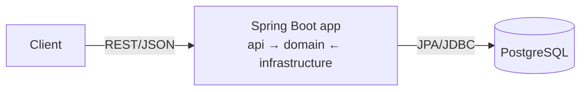
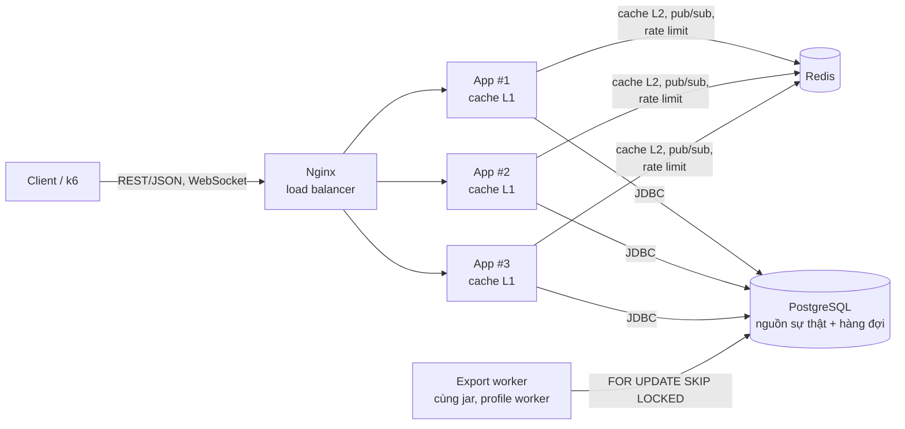
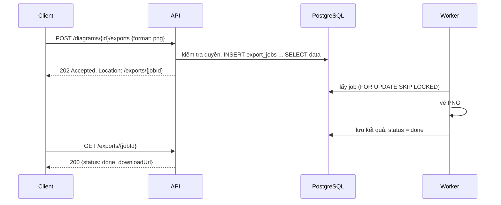

# Kế hoạch Pha 2 – DiagramIO

| | |
|---|---|
| Trạng thái | Đề xuất, chờ nhóm duyệt |
| Tiến độ | M0 xong: bộ đo, số liệu C0 trên Kaggle ([danh-gia-hien-trang.md](pha-2/danh-gia-hien-trang.md), [ADR-0001](adr/0001-phuong-phap-do.md), [bench/](../bench/README.md)) |
| Mốc so sánh (baseline) | `main` tại commit `35503aa`, gắn tag `v1.0-phase1` trước khi bắt đầu. C0 của mọi phép so sánh là mã này cộng phần đo của M0 (Actuator, Micrometer; không đổi hành vi), gắn tag `v2.0-m0` |
| Phần cứng đánh giá duy nhất | Kaggle Notebook CPU (4 vCPU, ~30 GB RAM); ghi lại `lscpu` ở mỗi phiên |
| Tài liệu liên quan | [README.md](../README.md), [AGENTS.md](../AGENTS.md), [luong-nghiep-vu.md](luong-nghiep-vu.md), [openapi.yaml](openapi.yaml) |

## 0. Tóm tắt

Pha 2 không phải là "thêm thật nhiều công nghệ". Đề bài yêu cầu ba việc: (1) đề xuất kiến trúc **dựa trên đánh giá** hệ thống hoặc đặc tả, (2) **đo trước và sau** trên đúng một cấu hình phần cứng, (3) **chỉ rõ vì sao** cải tiến có tác dụng. Vì vậy mỗi bài toán đi qua cùng một vòng lặp:

```
Đo hiện trạng → tìm nút thắt có bằng chứng → chọn chiến thuật kiến trúc → triển khai sau cờ cấu hình
→ đo lại cùng kịch bản, cùng dữ liệu, cùng máy → giải thích bằng số liệu phía server
```

Tám bài toán, chia theo nguồn gốc (đánh giá hệ thống hay đặc tả nghiệp vụ):

| # | Bài toán | Chiến thuật / mẫu kiến trúc | Nguồn | Ưu tiên |
|---|---|---|---|---|
| B1 | Mỗi request chạy thừa câu SQL và chở cột `data` (tới 2 MB) qua lại không cần thiết | Projection (CQRS-lite), UPDATE có điều kiện, chép dữ liệu ngay trong DB, index | Đánh giá | Must |
| B2 | Đường đọc sơ đồ lúc nào cũng chạm CSDL | Cache 2 tầng (Caffeine + Redis) write-through có so version, HTTP conditional request (ETag/304) | Đánh giá | Must |
| B3 | Mọi request có `X-Share-Token` đều tra CSDL, trong khi thu hồi link phải có hiệu lực ngay | Cache token dùng chung trên Redis, xóa sau commit | Đánh giá + đặc tả | Must |
| B4 | Chỉ chạy một bản app: không mở rộng được, tiến trình chết là ngừng dịch vụ | Stateless scale-out sau Nginx, health check, graceful shutdown | Đánh giá | Must |
| B5 | Đăng nhập (BCrypt) chiếm hết CPU và không chống dò mật khẩu | Rate limiting (token bucket), bulkhead, phát hiện refresh token bị dùng lại | Đánh giá | Must |
| B6 | Xuất PNG/SVG/PDF là tác vụ nặng (AGENTS.md xếp vào pha 2) | Queue-based load leveling, async request-reply (202), competing consumers, worker là tiến trình riêng | Đặc tả | Should |
| B7 | Mỗi phiên bản lưu một bản sao đầy đủ | Khử trùng lặp theo hash nội dung, nén LZ4 | Đánh giá + đặc tả | Should |
| B8 | Hai người cùng sửa thì người lưu sau nhận 409 | Sửa theo thao tác trên từng phần tử, server sắp thứ tự, WebSocket + Redis pub/sub | Đặc tả | Could (điểm cộng) |

Kiến trúc đích: **modular monolith** ba tầng (giữ nguyên quy tắc pha 1), chạy nhiều bản sau Nginx; Redis lo cache, pub/sub và rate limit; PostgreSQL vẫn là nguồn sự thật và kiêm luôn hàng đợi; thêm một tiến trình worker cho export. Không tách microservice (lý do ở mục 4.4).

Điều kiện tiên quyết: **M0, dựng lại phép đo, làm trước mọi tối ưu**, vì phép đo pha 1 có thể đang đo giới hạn của Locust chứ không phải của backend (mục 2.2).

## 1. Yêu cầu pha 2 và cách đáp ứng

| Yêu cầu đề bài | Cách đáp ứng | Bằng chứng nộp |
|---|---|---|
| Đề xuất kiến trúc dựa vào đánh giá hệ thống hoặc đặc tả | B1–B5, B7 xuất phát từ số liệu M0 (flame graph, số SQL mỗi request, CPU từng tiến trình); B6, B8 xuất phát từ đặc tả (export, cộng tác) | Báo cáo hiện trạng M0; mỗi bài toán có một ADR |
| Đánh giá trước và sau | Cùng harness, cùng dữ liệu, cùng kịch bản; cải tiến bật/tắt bằng cờ cấu hình để so A/B trên cùng một file jar | Bảng, biểu đồ trong `docs/pha-2/ket-qua.md`; CSV ở `bench/results/` |
| Chỉ rõ lý do | Mỗi kết quả gắn với một chỉ số phía server giải thích nó: số SQL, byte đọc từ DB, cache hit ratio, CPU, flame graph | Mục "Vì sao" trong từng ADR |
| Một cấu hình phần cứng (Kaggle CPU) | Mọi lần đo chạy trên Kaggle CPU; baseline và bản cải tiến chạy xen kẽ trong cùng phiên | Notebook Kaggle công khai, `env.txt` của mỗi phiên |
| Triển khai kiến trúc phù hợp từng bài toán | Mỗi bài toán một chiến thuật riêng, có phân tích đánh đổi; không áp một công nghệ cho mọi thứ | Code, test, ADR |
| Pha 1 vẫn phải đúng | Toàn bộ test hiện có và `ArchitectureTest` xanh; hợp đồng API cũ giữ nguyên, chỉ thêm | `./mvnw test` |

## 2. Hiện trạng sau pha 1

### 2.1 Kiến trúc

- Một tiến trình Spring Boot (Java 21), ba tầng `api → domain ← infrastructure`. Domain là Java thuần, `ArchitectureTest` (ArchUnit) kiểm tra.
- PostgreSQL là nơi lưu duy nhất, chưa có cache. Xác thực stateless: JWT và `X-Share-Token`, mỗi loại một filter.
- Chống ghi đè bằng `@Version`. Lưu và khôi phục phiên bản khóa dòng sơ đồ bằng `SELECT ... FOR UPDATE`.
- `Diagram.replaceContent` đã được chuẩn bị làm điểm nối cho pha 2 (sự kiện, cache, sửa theo thao tác).

Đây là một nền tốt: app không giữ trạng thái phiên, domain không phụ thuộc framework, nên thêm cache, hàng đợi hay nhiều instance mà không phải động vào luật nghiệp vụ.

### 2.2 Những điểm yếu của phép đo pha 1 (phải sửa trước)

1. **Chưa chắc đang đo backend.** Locust, app và PostgreSQL chạy chung 4 vCPU, không tiến trình nào bị giới hạn CPU. Ở 10 user, tổng RPS là 330 trong khi p95 chỉ 7 ms. Nếu kịch bản không có `wait_time`, mỗi user chỉ gửi ~33 request/s, tức mỗi vòng mất ~30 ms trong khi server chỉ tốn ~5 ms; phần lớn thời gian nằm ở phía client. Ở 100 user, RPS đứng yên ở ~747 còn độ trễ tăng gần tuyến tính (theo định luật Little: 100 / 747 ≈ 134 ms mỗi vòng), tức có tài nguyên đã bão hòa, nhưng chưa biết là Locust (Python), JVM hay PostgreSQL. Login p95 tăng từ 320 ms lên 590–660 ms, mà BCrypt là việc thuần CPU, nên CPU cả máy đã bão hòa. Bản thân Locust cũng báo độ trễ cao hơn thực tế khi nó thiếu CPU.
2. **Kịch bản không đại diện.** 100% là ghi, dữ liệu sơ đồ nhỏ, CSDL gần rỗng (100 user). Các vấn đề của đường đọc, danh sách, sơ đồ lớn, lịch sử dài không lộ ra.
3. **Không lặp lại được, không có độ lệch.** Đo trên `ca41f27` (trước PR #14); mỗi mức tải chạy một lần, không warm-up JVM.
4. **Không có số liệu phía server** (CPU từng tiến trình, pool kết nối, số SQL, GC), nên không giải thích được kết quả.
5. **Chỉ có mô hình tải đóng, không thời gian nghỉ.** Khi hệ thống chậm, tải tự giảm theo (coordinated omission), nên p95 bị đánh giá thấp hơn thực tế. Cần thêm mô hình tải mở (tốc độ đến cố định) cho các phép đo độ trễ.

Hệ quả: số liệu pha 1 được giữ để tham khảo, còn **baseline của pha 2 phải đo lại** bằng harness mới (M0) trên tag `v1.0-phase1`.

### 2.3 Điểm nghẽn dự đoán từ mã nguồn (giả thuyết, M0 sẽ xác nhận)

Các số dưới đây đếm từ code; M0 xác nhận lại bằng Hibernate statistics và `pg_stat_statements`.

| Endpoint | Câu SQL hiện tại | Số lần `data` đi giữa app và DB | Nguyên nhân |
|---|---|---|---|
| `PUT /diagrams/{id}` | 3: SELECT đủ cột, SELECT lại khi `merge`, UPDATE | 3 | Kiểm tra quyền đọc cả sơ đồ ([DiagramAccess.java:32](../src/main/java/com/diagramio/domain/access/DiagramAccess.java#L32)); `saveAndFlush` một entity tách rời nên Hibernate `merge` và đọc lại ([DiagramRepositoryAdapter.java:33](../src/main/java/com/diagramio/infrastructure/diagram/DiagramRepositoryAdapter.java#L33)) |
| `POST /diagrams/{id}/versions` | 4: khóa dòng, SELECT đủ cột, `max(version_number)`, INSERT | 2 | Dữ liệu được kéo lên app rồi đẩy xuống lại, chỉ để chép từ bảng này sang bảng kia |
| `POST .../versions/{vid}/restore` | 6: khóa, SELECT sơ đồ, SELECT phiên bản, max, INSERT bản sao lưu, UPDATE | 4 | Như trên |
| `POST /diagrams/{id}/shares` | 4: SELECT sơ đồ đủ cột (chỉ để kiểm tra chủ), kiểm tra token trùng, SELECT do `merge`, INSERT | 1 | `save()` với id gán sẵn nên Spring Data coi là bản ghi cũ và `merge` ([DiagramShareRepositoryAdapter.java:45](../src/main/java/com/diagramio/infrastructure/share/DiagramShareRepositoryAdapter.java#L45)); `users`, `refresh_tokens` bị y hệt |
| Mọi request có `X-Share-Token` | Thêm 1 SELECT `diagram_shares` | 0 | Filter tra DB ở mọi request ([ShareTokenAuthenticationFilter.java:40](../src/main/java/com/diagramio/infrastructure/security/ShareTokenAuthenticationFilter.java#L40)) |
| `GET /shares/{token}`, `GET /diagrams/{id}` | 2 | 1 | Chưa có cache |
| `GET /diagrams` (sơ đồ của tôi) | Tới 4 (hai lần lấy trang, hai lần COUNT) | Tới 100 sơ đồ × 2 MB | Controller gọi service hai lần ([DiagramController.java:67-68](../src/main/java/com/diagramio/api/diagram/DiagramController.java#L67-L68)); entity luôn nạp cột `data` dù response không trả |
| `GET /diagrams/{id}/versions` | 2 | 1 + **dữ liệu của mọi snapshot** | Nạp `data` của mọi phiên bản ([DiagramVersionRepositoryAdapter.java:49](../src/main/java/com/diagramio/infrastructure/version/DiagramVersionRepositoryAdapter.java#L49)) chỉ để trả danh sách tóm tắt |

Các điểm khác:

- Phân trang không có `ORDER BY` ([DiagramRepositoryAdapter.java:47](../src/main/java/com/diagramio/infrastructure/diagram/DiagramRepositoryAdapter.java#L47)) nên thứ tự giữa các trang không ổn định, có thể trùng hoặc sót bản ghi. Đây là lỗi đúng đắn, sửa luôn trong B1.
- Thiếu index: `diagram_shares(diagram_id)` (khóa ngoại, dùng khi liệt kê link và khi xóa sơ đồ kéo theo cascade), `diagrams(owner_id, updated_at)`, `is_public`. Tìm theo tên sinh ra `upper(title) like upper('%x%')`, phải quét tuần tự.
- Ghi sơ đồ: Jackson parse body thành `JsonNode`, gọi `toString()`, rồi `DiagramData.of` parse thêm lần nữa ([DiagramController.java:132](../src/main/java/com/diagramio/api/diagram/DiagramController.java#L132), [DiagramData.java:43](../src/main/java/com/diagramio/domain/diagram/DiagramData.java#L43)). Một payload 2 MB bị parse 2 lần và serialize 1 lần.
- BCrypt cost 10 (~50–100 ms CPU mỗi lần) chạy không giới hạn số lượng đồng thời, không có rate limit.
- Pool Hikari mặc định 10, Tomcat 200 luồng, JVM không đặt heap. `docker-compose.yml` đặt `container_name` và `ports` cho `app`, nên `docker compose up --scale app=3` không chạy được.

## 3. Phương pháp đánh giá (M0) – làm đầu tiên

### 3.1 Môi trường Kaggle

- Kaggle không chạy được Docker, nên mọi thành phần được cài trực tiếp bằng `bench/kaggle/setup.sh`: JDK 21, PostgreSQL 16 (từ PGDG), Redis 7, Nginx, k6, async-profiler, sysstat. Notebook phải bật Internet. Docker Compose vẫn giữ cho máy dev; nâng image Postgres trong compose và Testcontainers lên 16 để khớp với Kaggle.
  - *Đã làm ở M0:* `setup.sh` cài những gì M0 cần (PostgreSQL 16, JDK Temurin 21.0.13.1, k6 v2.3.0, async-profiler 4.6, có kiểm tra SHA-256); Redis và Nginx thêm vào ở M2, M3 khi bắt đầu dùng; `sysstat` được thay bằng `bench/collect/procstat.py` (mục 3.5). Image Kaggle CPU hiện dựng trên image Colab (Python 3.13), nên script tự nhận bản Ubuntu/Debian; đã chạy thử trên container Ubuntu 22.04 và 24.04.
- Đầu mỗi phiên ghi `lscpu`, `nproc`, `free -h` và phiên bản phần mềm vào `bench/results/<lần chạy>/env.txt`.
- **Phân CPU cố định cho mọi cấu hình**, ví dụ `taskset -c 0-2` cho hệ thống được đo (app, PostgreSQL, Redis, Nginx) và `taskset -c 3` cho công cụ tạo tải. Xem `lscpu -e` để biết cặp hyper-thread và ghi bố trí vào báo cáo.
- JVM cố định: `-Xms2g -Xmx2g -XX:+UseG1GC -XX:ActiveProcessorCount=<số CPU được cấp>`. Cấu hình PostgreSQL (`shared_buffers`, `max_connections`, `shared_preload_libraries = pg_stat_statements`) đặt một lần trong `setup.sh` và dùng chung cho baseline lẫn bản cải tiến.
- **Baseline và bản cải tiến chạy xen kẽ trong cùng một phiên Kaggle**, vì máy có thể khác nhau giữa các phiên. Nếu phải chia nhiều phiên, phiên nào cũng chạy lại C0 làm nhóm đối chứng.

### 3.2 Dữ liệu

Dữ liệu được sinh xác định (seed cố định) bằng `bench/seed/gen.py`, ghi ra CSV rồi `COPY` vào PostgreSQL. Quy mô gợi ý, chỉnh theo thời gian và dung lượng đĩa của Kaggle:

| Bảng | Số dòng | Ghi chú |
|---|---|---|
| `users` | 2.000 | Dùng chung một hash BCrypt tính sẵn để seed nhanh |
| `diagrams` | 50.000 | Chủ sở hữu phân bố lệch (vài user có 1.000+ sơ đồ để thử danh sách, tìm kiếm); 10% công khai |
| Kích thước `data` | 80% ~5 KB, 18% ~50 KB, 2% ~500 KB–1,5 MB | Node có `id, type, label, x, y, width, height, attributes` để B6 vẽ lại được |
| `diagram_versions` | ~150.000 | Phân bố lệch, vài sơ đồ có 200+ phiên bản |
| `diagram_shares` | 20.000 | |

- Seed xong thì `CREATE DATABASE bench_template`. Trước **mỗi** lần chạy: `DROP DATABASE run; CREATE DATABASE run TEMPLATE bench_template`. Mọi lần chạy bắt đầu từ cùng một trạng thái; dữ liệu ghi của lần trước không làm chậm lần sau.
- Danh sách user, sơ đồ, token cho kịch bản tải được xuất ra CSV cố định. Sơ đồ được chọn theo phân bố Zipf (s ≈ 1) để có "sơ đồ nóng" như thực tế.

### 3.3 Kịch bản tải

| ID | Mô tả | Dùng để đo |
|---|---|---|
| W1 | Giữ nguyên chuỗi 5 bước của pha 1: tạo, sửa + snapshot, khôi phục, tạo link, mở link | Nối tiếp với số liệu pha 1 |
| W2 | Hỗn hợp thực tế ~85% đọc / 15% ghi: mở sơ đồ, mở qua link, đọc kèm `X-Share-Token`, thăm lại kèm `If-None-Match`, danh sách của tôi có tìm theo tên, danh sách công khai, lịch sử; sửa, snapshot, khôi phục, tạo link | Kịch bản chính cho B1–B4 |
| W3 | Như W2 nhưng chỉ dùng sơ đồ 500 KB–1,5 MB | Payload lớn: B1, B7 |
| W4 | 20–50 người cùng sửa một sơ đồ, mỗi người 1 lần/giây, mỗi người một phần tử khác nhau | Tranh chấp, tỉ lệ 409: B8 |
| W5 | W2 ở tốc độ cố định, cộng bão đăng nhập 100 lần/s (một phần sai mật khẩu) trong 60 s | Cô lập tài nguyên: B5 |
| W6 | W2 ở tốc độ cố định, cộng 30 yêu cầu export PNG sơ đồ lớn trong 10 s | Tác vụ nặng: B6 |
| W7 | W2 ở tốc độ cố định qua 3 instance; `kill -9` một instance ở giây 60, bật lại ở giây 120 | Sẵn sàng: B4 |

### 3.4 Công cụ, mô hình tải, thời lượng

- **Công cụ chính là k6** (một file thực thi viết bằng Go). Lý do: tốn ít CPU hơn Locust nên ít tranh CPU với hệ thống được đo; có executor theo tốc độ đến (`constant-arrival-rate`, `ramping-arrival-rate`) cho mô hình tải mở; hỗ trợ WebSocket (cần cho B8); có `thresholds` để chấm đạt hay không đạt SLO. Locust chỉ giữ để chạy lại W1 đúng như pha 1 và kiểm tra hai công cụ cho kết quả khớp nhau ở tải thấp.
  - *Đã làm ở M0:* không giữ Locust. Kịch bản Locust gốc chỉ có trong notebook Kaggle của pha 1, không có trong repo và không đọc được ngoài Kaggle, nên không thể chạy lại "đúng như pha 1"; W1 của k6 dựng lại cùng chuỗi 6 request và cùng mức tải 10/50/100 VU.
- Mỗi cấu hình đo hai kiểu:
  - **Sức chứa:** tăng dần tốc độ đến (ví dụ từ 100 lên 3.000 req/s, mỗi bậc 60 s) cho tới khi p95 > 100 ms hoặc lỗi > 1%. Chỉ số chính là **throughput tối đa còn giữ được SLO**.
  - **Độ trễ ở tải cố định:** chạy ở vài mức (ví dụ 200, 500, 800 req/s), lấy p50, p95, p99, tỉ lệ lỗi, CPU.
- Mỗi lần chạy: warm-up 60 s (JIT, cache) không tính, đo 180 s, lặp 3 lần; báo cáo trung vị và khoảng min–max. Khởi động lại JVM và reset DB giữa các cấu hình.
- Kiểm tra công cụ tạo tải không phải nút thắt: CPU của k6 phải dưới 80% nhân được cấp; nếu vượt thì giảm tải hoặc ghi rõ giới hạn trong báo cáo.

### 3.5 Đo phía server

- Thêm `spring-boot-starter-actuator` và `micrometer-registry-prometheus`; mở `/actuator/prometheus` trên cổng quản trị riêng, chỉ nghe localhost. Bật histogram cho `http.server.requests`. Một script Python cào số liệu mỗi 5 s ra CSV, không cần dựng Prometheus hay Grafana trên Kaggle.
- Chỉ số theo dõi: CPU từng tiến trình (`pidstat -u 5`), `hikaricp.connections.pending` và `active`, `jvm.gc.pause`, số luồng Tomcat đang bận, cache hit ratio, độ dài hàng đợi export, số phiên WebSocket.
  - *Đã làm ở M0:* CPU từng tiến trình đọc thẳng `/proc` (`bench/collect/procstat.py`) thay cho `pidstat`, để gộp mọi backend của PostgreSQL thành một nhóm và ghi thêm `steal`, độ bận từng CPU. Số câu SQL mỗi request đo bằng test `SqlPerRequestE2eTest` thay cho profile `profiling` (số liệu xác định, không cần Kaggle), đối chiếu với `pg_stat_statements` trong mỗi lần đo.
- PostgreSQL: gọi `pg_stat_statements_reset()` đầu mỗi lần chạy; cuối lần chạy xuất các câu lệnh tốn thời gian nhất và số lần gọi; ghi `pg_total_relation_size` của các bảng.
- **Số câu SQL mỗi request:** chạy một lượt đếm riêng với `hibernate.generate_statistics` (hoặc datasource-proxy) ở profile `profiling`; không bật khi đo hiệu năng.
- **Flame graph CPU** (async-profiler, 60 s ở giữa lượt đo) cho C0 và bản cuối trên W2, W3, để có hình trước và sau cho báo cáo.

### 3.6 Kịch bản thuộc tính chất lượng

Viết theo mẫu của Bass, Clements, Kazman (*Software Architecture in Practice*): nguồn, kích thích, môi trường, phản hồi, thước đo. Cột mục tiêu chỉ để định hướng; con số chốt sau M0.

| ID | Thuộc tính | Kích thích và môi trường | Thước đo phản hồi | Mục tiêu tham khảo | Bài toán |
|---|---|---|---|---|---|
| QA-P1 | Hiệu năng đọc | W2, tăng tải tới bão hòa | Throughput tối đa với p95 ≤ 100 ms, lỗi < 1% | ≥ 2 lần C0 | B1, B2, B3 |
| QA-P2 | Hiệu năng ghi payload lớn | W3 | SQL mỗi request, byte giữa app và DB, p95 | SQL giảm ≥ 50%, p95 giảm | B1 |
| QA-P3 | Danh sách, tìm kiếm | User có 2.000 sơ đồ, tìm theo tên | p95; không đọc cột `data` | p95 ≤ 50 ms | B1 |
| QA-S1 | Khả năng mở rộng | 1, 2, 3 instance trên W2 | Throughput theo số instance; không sửa code | Không giảm; giải thích được trần CPU | B4 |
| QA-A1 | Sẵn sàng | W7: một instance chết đột ngột | Tỉ lệ lỗi trong cửa sổ sự cố, thời gian hồi phục | Lỗi < 1%, hồi phục < 10 s | B4 |
| QA-R1 | Cô lập tài nguyên, bảo mật | W5: bão đăng nhập | p95 các endpoint khác so với lúc không có bão; số lần thử sai trước khi bị chặn | p95 tăng ≤ 20%; chặn sau 5 lần sai mỗi email | B5 |
| QA-P4 | Tác vụ nặng | W6: dồn yêu cầu export | p95 các API khác, % job hoàn thành, thời gian chờ job | p95 tăng ≤ 20%, 100% job xong | B6 |
| QA-ST1 | Dung lượng | 1.000 sơ đồ × 50 snapshot (mỗi lần sửa ~2%) kèm khôi phục | Dung lượng bảng phiên bản | Giảm ≥ 50% | B7 |
| QA-C1 | Cộng tác | W4: 20 người cùng sửa | Tỉ lệ 409, byte mỗi lần sửa, độ trễ lan truyền p95 | 409 ≈ 0 khi sửa khác phần tử; lan truyền ≤ 200 ms | B8 |
| QA-SEC1 | Bảo mật khi có cache | Thu hồi link ở instance A, dùng token ở instance B ngay sau đó | Request đầu tiên sau khi thu hồi bị từ chối | 100% | B3 |
| QA-M1 | Khả năng sửa đổi | Thêm cache, Redis, hàng đợi, WebSocket | Domain không import thư viện mới; `ArchitectureTest` xanh | Đạt | Tất cả |

### 3.7 Các phép so sánh

Cấu hình cộng dồn, mỗi bước thêm một cải tiến để thấy phần đóng góp riêng (ablation):

| Cấu hình | Nội dung |
|---|---|
| C0 | Baseline `v1.0-phase1` |
| C1 | C0 + B1 |
| C2 | C1 + B2, B3, một instance, cache Caffeine |
| C3 | C2 + Redis (cache 2 tầng), vẫn một instance, để đo riêng chi phí của Redis |
| C4 | C3 chạy 2 rồi 3 instance sau Nginx |
| C5 | C4 + B5 |
| C-final | Tất cả cải tiến |

| Bài toán | Trước | Sau | Kịch bản | Chỉ số chính |
|---|---|---|---|---|
| B1 | C0 | C1 | W1, W2, W3 | SQL mỗi request, throughput giữ SLO, p95 |
| B2, B3 | C1 | C2, C3 | W2, W3 | Hit ratio, số truy vấn DB/s, CPU PostgreSQL, throughput |
| B4 | C3 (1 instance) | C4 (2, 3 instance) | W2, W7 | Đường cong mở rộng, lỗi khi có sự cố |
| B5 | C4, cờ tắt | C5 | W5 | p95 các endpoint khác trong lúc bão |
| B6 | Export đồng bộ | Export bất đồng bộ + worker | W6 | p95 API, thời gian hoàn thành job |
| B7 | Trước migration | Sau migration | Sinh phiên bản, W3 | Dung lượng, độ trễ snapshot và khôi phục |
| B8 | PUT toàn bộ sơ đồ | PATCH thao tác + WebSocket | W4 | Tỉ lệ 409, byte mỗi lần sửa, độ trễ lan truyền |
| Tổng | C0 | C-final | W1, W2, W3 | Kết quả tổng của pha 2 |

- Cải tiến nào làm được thì đặt sau cờ cấu hình (`diagramio.cache.mode`, `diagramio.ratelimit.enabled`, `diagramio.export.mode`, ...) để so A/B trên **cùng một file jar**. B1 đổi câu truy vấn nên so theo tag.
- B6 cần một bản "trước" để so, nên làm cả export đồng bộ (đơn giản) lẫn bất đồng bộ, chuyển bằng `diagramio.export.mode=sync|async`.
- Ước lượng: mỗi lần chạy mất ~5–6 phút (reset DB, khởi động, warm-up, đo). Các phép so sánh trên, mỗi phép lặp 3 lần, tổng khoảng 6–8 giờ, nên chia 2 phiên Kaggle (tối đa 12 giờ mỗi phiên), phiên nào cũng chạy C0 đối chứng. Ghi kết quả vào `/kaggle/working` ngay sau từng lần chạy để không mất khi phiên dừng.

### 3.8 Thư mục bench

```
bench/
├── README.md               cách chạy lại toàn bộ từ một notebook trắng
├── kaggle/
│   ├── setup.sh            cài JDK, PostgreSQL, Redis, Nginx, k6, async-profiler; cấu hình PostgreSQL
│   ├── start.sh            khởi động một cấu hình (C0..C-final): taskset, cờ, số instance
│   └── run_matrix.sh       chạy các phép so sánh × kịch bản × lần lặp
├── seed/gen.py             sinh dữ liệu xác định → CSV → COPY
├── k6/                     w1.js .. w7.js, lib/ (đăng nhập, chọn sơ đồ theo Zipf)
├── locust/w1_phase1.py     kịch bản pha 1, giữ nguyên
├── collect/                pidstat, cào /actuator/prometheus, xuất pg_stat_statements
├── analysis/report.py      gộp CSV thành bảng markdown và biểu đồ PNG
└── results/<ngày>_<cấu hình>_<kịch bản>_<lần>/   summary CSV được commit, log thô thì không
```

*Đã làm ở M0:* cấu trúc thực tế có thay đổi nhỏ, mô tả trong [bench/README.md](../bench/README.md): `start.sh` tách thành `build.sh`, `prepare_data.sh`, `run_one.sh` cùng `env.sh` dùng chung; W3 là `w2.js` chạy với `SIZE_CLASS=L`; không có thư mục `locust/` (mục 3.4); kết quả nằm ở `results/<thời điểm>-<ma trận>/<cấu hình>_<kịch bản>_<mô hình><mức>_r<lần>/`. W4-W7 thêm vào cùng các bài toán dùng chúng.

Đầu ra của M0 là `docs/pha-2/danh-gia-hien-trang.md`: nút thắt thật, flame graph, số SQL mỗi request, CPU từng tiến trình. **Thứ tự B1–B8 ở mục 5 là tạm thời; nếu M0 chỉ ra nút thắt khác thì đổi ưu tiên theo số liệu.**

## 4. Kiến trúc đích

### 4.1 Sơ đồ container

Pha 1:



Pha 2:



### 4.2 Nguyên tắc giữ kiến trúc

1. **Giữ ba tầng.** Mọi thứ mới (cache, Redis, hàng đợi, renderer, WebSocket) là adapter trong `infrastructure`; domain chỉ thấy interface (port). Mở rộng `ArchitectureTest`: domain không được phụ thuộc `com.github.benmanes.caffeine..`, `io.lettuce..`, `redis.clients..`, `io.github.bucket4j..`, `org.apache.batik..`, `org.apache.pdfbox..`.
2. **Việc cắt ngang (cross-cutting) dùng decorator hoặc filter**, không rải vào service: `CachingDiagramRepository` bọc `DiagramRepository`, `BoundedPasswordHasher` bọc `PasswordHasher`, rate limit là một filter giống các filter xác thực.
3. **Tác dụng phụ chạy sau commit.** Ghi hay xóa cache, phát sự kiện, đẩy WebSocket chỉ chạy sau khi transaction commit (`TransactionSynchronization.afterCommit`), đúng quy tắc "không gọi hệ thống ngoài trong transaction" của AGENTS.md.
4. **PostgreSQL vẫn là nguồn sự thật.** Cache mất lúc nào hệ thống vẫn đúng, chỉ chậm hơn.
5. **Hợp đồng API cũ giữ nguyên;** chỉ thêm endpoint, header, mã trạng thái mới (ETag, 202, 304, 412, 429, 503). Cập nhật `docs/openapi.yaml`.
6. **Không có số đo trước và sau thì không merge.**

### 4.3 Port và adapter mới

| Port (domain) | Adapter (infrastructure) | Bài toán |
|---|---|---|
| `DiagramRepository`, thêm `findAccessInfo`, `findSummaries`, `updateIfVersion` | `DiagramRepositoryAdapter` (JPA + SQL viết tay), `CachingDiagramRepository` (decorator) | B1, B2 |
| `DiagramVersionRepository`, thêm `snapshotCurrent`, `restoreFrom`, `findSummaries` | Adapter SQL | B1, B7 |
| `DiagramShareRepository` | `CachingShareRepository` (decorator) | B3 |
| `PasswordHasher` | `BoundedPasswordHasher` (decorator) | B5 |
| `ExportJobRepository`, `DiagramRenderer` | `JdbcExportJobRepository`, `SvgRenderer`, `PngRenderer`, `PdfRenderer` | B6 |
| `DiagramEventPublisher` | `RedisDiagramEventPublisher` (chạy sau commit) | B8, dùng lại để hủy cache L1 của B2 |
| Không có (filter, interceptor) | `RateLimitFilter`, STOMP `ChannelInterceptor` | B5, B8 |

### 4.4 Phương án đã cân nhắc nhưng không chọn

| Phương án | Lý do không chọn |
|---|---|
| Tách microservice (auth, diagram, version, share) | Trên một máy 4 vCPU, việc gọi qua mạng và serialize giữa các service cùng nhiều JVM làm hiệu năng giảm. Các module dùng chung bảng `diagrams` và luật quyền `Caller`, tách DB là việc lớn mà không gỡ được nút thắt nào đo được. Chỉ tách **một** tiến trình có hồ sơ tài nguyên khác hẳn phần còn lại: worker export (B6) |
| Kafka, RabbitMQ | Quá nặng cho 4 vCPU. Hàng đợi export và phát sự kiện đủ dùng với PostgreSQL `SKIP LOCKED` và Redis pub/sub |
| Bản sao chỉ đọc của PostgreSQL | Trên cùng một máy không có thêm CPU hay đĩa, chỉ thêm tải sao chép; cache (B2) giảm tải đọc hiệu quả hơn. Ghi vào hướng tiếp theo khi có nhiều máy |
| CRDT (Yjs, Automerge) cho cộng tác | Sơ đồ là tập phần tử có id, không phải chuỗi văn bản: thao tác trên các phần tử khác nhau vốn giao hoán, chỉ cần server sắp thứ tự (B8). CRDT cần thư viện phía client và metadata lớn |
| Lưu phiên bản dạng delta (JSON Patch) | Khôi phục phải cộng dồn nhiều patch nên chậm và phức tạp; hash nội dung + nén LZ4 lấy được phần lớn lợi ích (B7) |
| Kubernetes | Kaggle không chạy container; ngoài phạm vi môn học |
| Nén gzip mọi response làm cải tiến chính | Đo trên localhost thì chỉ tốn thêm CPU mà không có lợi về băng thông. Chỉ báo cáo số byte tiết kiệm được; có thể bật ở Nginx khi triển khai thật |

## 5. Các bài toán và giải pháp

Mỗi bài toán được trình bày theo cùng một khung: bài toán → chiến thuật → triển khai → đo → xong khi → đánh đổi.

### B1. Tối ưu truy cập dữ liệu (Must)

**Bài toán.** Theo bảng ở mục 2.3, mỗi request chạy thừa câu SQL và kéo cột `data` lên app mà không dùng. Với sơ đồ lớn, mỗi lần như vậy tốn đọc TOAST, chuyển JSONB sang text, truyền qua socket và cấp phát một chuỗi 2 MB.

**Chiến thuật.** Giảm tài nguyên mỗi request: chỉ đọc cột cần thiết (projection, tách mô hình đọc khỏi mô hình ghi theo kiểu CQRS-lite), gộp đọc-sửa-ghi thành một câu có điều kiện, để PostgreSQL tự chép dữ liệu trong DB.

**Triển khai.**

1. **Kiểm tra quyền mà không đọc `data`.** Thêm record domain `DiagramAccessInfo(id, ownerId, isPublic, version)` và `DiagramRepository.findAccessInfo(id)` (SELECT 4 cột). `Caller` và `Permission` làm việc trên `DiagramAccessInfo` (`Diagram` cung cấp `accessInfo()`); `DiagramAccess.require` trả `DiagramAccessInfo`, service nào cần nội dung mới gọi `findById`. Áp dụng cho chia sẻ (MANAGE), xóa, lịch sử (VIEW_HISTORY), snapshot.
2. **PUT chỉ cần một câu ghi.**
   ```sql
   UPDATE diagrams
   SET title = :title, diagram_type = :type, data = :data::jsonb, is_public = :isPublic,
       updated_by = :by, updated_at = :now, version = version + 1
   WHERE id = :id AND version = :expectedVersion
   RETURNING *;
   ```
   Không dòng nào bị sửa thì trả 409 (tồn tại và quyền đã kiểm tra bằng `findAccessInfo`). Câu lệnh nằm trong adapter (`JdbcTemplate` hoặc native query); domain vẫn chỉ gọi port. Từ 3 SQL và 3 lần chở `data` còn 2 SQL và 1 lần (1 SQL khi access info có sẵn trong cache của B2).
3. **Snapshot và khôi phục chép ngay trong DB.**
   ```sql
   -- Lưu phiên bản (sau SELECT ... FOR UPDATE như pha 1)
   INSERT INTO diagram_versions (id, diagram_id, version_number, data, note, created_by, created_at)
   SELECT :vid, d.id,
          COALESCE((SELECT max(version_number) FROM diagram_versions WHERE diagram_id = d.id), 0) + 1,
          d.data, :note, :by, now()
   FROM diagrams d
   WHERE d.id = :id AND (CAST(:expected AS int) IS NULL OR d.version = :expected)
   RETURNING version_number, data, created_at;

   -- Khôi phục: chèn bản sao lưu như trên, rồi
   UPDATE diagrams d
   SET data = v.data, version = d.version + 1, updated_by = :by, updated_at = now()
   FROM diagram_versions v
   WHERE d.id = :id AND v.id = :vid AND v.diagram_id = d.id
   RETURNING d.*;
   ```
   Giữ khóa dòng và `UNIQUE (diagram_id, version_number)` như pha 1. Snapshot từ 4 xuống 2 SQL, khôi phục từ 6 xuống 3 SQL; `data` chỉ đi lên app một lần để trả response, nên hợp đồng API giữ nguyên.
4. **Danh sách.** Truy vấn projection không có `data` (record `DiagramSummary` trong domain), luôn có `ORDER BY updated_at DESC, id`; đếm tổng một lần (controller không gọi service hai lần; dùng `count(*) OVER()` hoặc đúng một câu COUNT). Lịch sử phiên bản cũng dùng projection không có `data`. Tùy chọn: phân trang theo con trỏ (`?cursor=`) cho trang sâu, vẫn giữ `page` và `size` cũ.
5. **Index** (migration mới, ví dụ `V4__phase2_indexes.sql`):
   ```sql
   CREATE INDEX idx_diagrams_owner_updated  ON diagrams (owner_id, updated_at DESC, id);
   CREATE INDEX idx_diagrams_public_updated ON diagrams (updated_at DESC, id) WHERE is_public;
   CREATE EXTENSION IF NOT EXISTS pg_trgm;
   CREATE INDEX idx_diagrams_title_trgm     ON diagrams USING gin (title gin_trgm_ops);
   CREATE INDEX idx_diagram_shares_diagram  ON diagram_shares (diagram_id);
   ```
   Truy vấn tìm tên phải viết lại thành `title ILIKE '%' || :q || '%'` thì mới dùng được index trigram (`ContainingIgnoreCase` của Spring Data sinh `upper(title) like upper(?)`, không khớp index). Đính kèm `EXPLAIN (ANALYZE, BUFFERS)` trước và sau vào báo cáo.
6. **Thêm mới không qua `merge`.** Entity có id gán sẵn (`users`, `refresh_tokens`, `diagram_shares`) cài `Persistable<UUID>` với `isNew = true` khi tạo, để Spring Data gọi `persist`. Bỏ được một SELECT ở đăng ký, đăng nhập, refresh, tạo link. Bỏ luôn câu kiểm tra token trùng; dựa vào ràng buộc UNIQUE và thử lại nếu trùng (gần như không xảy ra với 24 byte ngẫu nhiên).
7. **Chỉ parse JSON một lần.** `DiagramData.of(JsonNode)` kiểm tra cấu trúc trên cây Jackson đã có rồi serialize một lần, thay cho `toString()` rồi parse lại; hoặc kiểm tra bằng streaming parser. Chỉ làm nếu flame graph M0 cho thấy chi phí JSON đáng kể.
8. **Tinh chỉnh runtime, mỗi lần một biến:** kích thước pool Hikari (8, 16, 32), virtual threads của Java 21 (`spring.threads.virtual.enabled=true`), số luồng Tomcat. Đo riêng từng thay đổi trên W2, chỉ giữ cái có lợi.
9. **Thử nghiệm tùy chọn:** cột `data` kiểu `jsonb` so với `json`. Ứng dụng chưa bao giờ truy vấn vào bên trong JSON mà `jsonb` tốn parse lúc ghi và dựng lại text lúc đọc. Chỉ đổi nếu W3 cho thấy lợi rõ; đánh đổi là mất dạng chuẩn hóa mà B7 dùng để băm.

**Đo.** W1, W2, W3 từ C0 sang C1. Bảng số SQL mỗi request trước và sau (từ lượt đếm), các câu lệnh hàng đầu trong `pg_stat_statements`, số block đọc (`shared_blks_hit`, `shared_blks_read`), p95, throughput, `EXPLAIN` của danh sách và tìm kiếm.

**Xong khi.** Toàn bộ test cũ xanh, kể cả `DiagramVersionConcurrencyTest`; thêm test phân trang ổn định và test 409 cho UPDATE có điều kiện; số liệu C1 có trong báo cáo.

**Đánh đổi.** Có một ít SQL viết tay trong adapter, khó đổi hệ CSDL hơn. Chấp nhận được vì nằm gọn trong `infrastructure`, domain không đổi.

### B2. Cache 2 tầng cho đường đọc và HTTP conditional request (Must)

**Bài toán.** Với một công cụ vẽ, đọc chiếm phần lớn lưu lượng: mở sơ đồ, xem qua link, client thăm lại định kỳ để thấy thay đổi của người khác. Lần nào cũng đọc DB và gửi lại tới 2 MB. Phiên bản là bất biến nhưng vẫn đọc DB mỗi lần.

**Chiến thuật.** Giữ nhiều bản sao dữ liệu (cache), và bỏ việc gửi lại thứ client đã có (304 Not Modified).

**Triển khai.**

1. **Decorator.** `CachingDiagramRepository implements DiagramRepository` trong `infrastructure`, bọc adapter JPA: `findById`, `findAccessInfo` đọc cache trước; `updateIfVersion`, `deleteById` ghi DB rồi cập nhật cache sau commit. Domain không đổi.
2. **Hai tầng.** L1 là Caffeine trong JVM, giới hạn theo byte (ví dụ 256 MB, `maximumWeight` theo độ dài JSON), TTL 10 phút. L2 là Redis dùng chung giữa các instance, TTL 30 phút. Chọn bằng `diagramio.cache.mode=none|local|redis|two-level` để đo riêng từng chế độ.
3. **Tính nhất quán (phần quan trọng nhất của bài toán này).**
   - **Write-through có so version:** sau `UPDATE ... RETURNING` (B1) đã có trạng thái mới, nên ghi thẳng vào cache, **chỉ khi version mới lớn hơn version đang có** (Caffeine dùng `asMap().compute`, Redis dùng một Lua script). Nhờ vậy một request đọc chậm không thể ghi đè bản cũ lên bản mới, đây là lỗi kinh điển của cache-aside chỉ xóa key.
   - `Diagram` là đối tượng mutable (service gọi `updateMetadata`, `replaceContent` trên nó), nên cache lưu một bản bất biến và trả một `Diagram` mới cho mỗi lần đọc. Nếu trả chung một đối tượng, một request đang sửa dở sẽ làm bẩn cache. `DiagramData` vốn bất biến nên sao chép rất rẻ.
   - Xóa sơ đồ thì ghi một "bia mộ" (tombstone) ngắn hạn thay vì chỉ xóa key.
   - Nhiều instance: sau commit `PUBLISH diagram-changed {id, version}`; instance khác bỏ bản L1 nếu version của nó cũ hơn.
   - Mô hình nhất quán ghi trong ADR: người vừa ghi luôn đọc được bản mới (read-your-writes); người ở instance khác có thể thấy bản cũ trong vài ms (độ trễ pub/sub); ghi luôn an toàn vì `version` được kiểm tra ở DB.
4. **Dữ liệu bất biến và micro-cache.** Snapshot phiên bản được cache không hạn (chỉ xóa khi xóa sơ đồ). Danh sách công khai cache 5 giây, chấp nhận trễ tối đa 5 s.
5. **ETag và 304.** `GET /diagrams/{id}` trả `ETag: "<version>"` và `Cache-Control: private, no-cache`; request có `If-None-Match` khớp thì nhận 304 không body, **sau khi** đã kiểm tra quyền, để không lộ sơ đồ riêng tư. `GET /shares/{token}` dùng ETag `"<version>-<role>"`. `GET /versions/{vid}` trả `Cache-Control: private, max-age=31536000, immutable`. Không dùng `ShallowEtagHeaderFilter` vì nó vẫn phải sinh body rồi băm, chỉ tiết kiệm băng thông chứ không tiết kiệm CPU. Tùy chọn: nhận `If-Match` cho PUT (trả 412) như cách chuẩn của HTTP, vẫn giữ trường `version` trong body.
6. **Chống dồn tải khi miss (stampede):** Caffeine `get(key, loader)` gộp các lần nạp cùng một key trong một instance.
7. **Số liệu:** Micrometer cho Caffeine (hit, miss, eviction), bộ đếm hit/miss cho Redis.

**Đo.** W2, W3: C1, C2 (local), C3 (hai tầng, một instance, để thấy chi phí gọi Redis), C4. Chỉ số: hit ratio, số truy vấn DB mỗi giây, CPU của PostgreSQL, p95, throughput tối đa, tỉ lệ 304 và số byte tiết kiệm.

**Xong khi.** Có test cho: sửa xong thì GET thấy bản mới (một và hai instance); đọc chậm không ghi đè được bản mới (test race có điều phối luồng); đổi `isPublic` thì khách mất quyền ngay; xóa sơ đồ thì 404; 304 không có body và không bao giờ trả cho người không có quyền; tắt Redis giữa chừng thì hệ thống vẫn chạy bằng DB, chỉ chậm hơn.

**Đánh đổi.** Thêm một thành phần (Redis) và thêm độ phức tạp về nhất quán. Giá trị lớn tốn RAM, nên giới hạn theo byte và có thể không cache sơ đồ vượt ngưỡng (ví dụ 1 MB).

### B3. Cache xác thực link chia sẻ, thu hồi có hiệu lực ngay (Must)

**Bài toán.** Filter `X-Share-Token` tra `diagram_shares` ở mọi request của người cầm link; `GET /shares/{token}` đọc thêm cả sơ đồ. Nhưng đặc tả bắt buộc thu hồi link phải mất hiệu lực **ngay** từ request sau.

**Chiến thuật.** Cache, với mức nhất quán chọn theo yêu cầu nghiệp vụ: quyền truy cập cần nhất quán chặt hơn nội dung sơ đồ.

**Triển khai.**

1. Decorator `CachingShareRepository` cho `findByShareToken`. Key là SHA-256 của token (không lưu token gốc trong Redis), value là `(shareId, diagramId, role)`.
2. **Một instance:** Caffeine, xóa đồng bộ khi thu hồi hoặc đổi quyền, nên đúng ngay.
3. **Nhiều instance:** cache token **chỉ ở Redis**, không có L1. Thu hồi thì xóa key sau commit, mọi instance thấy ngay ở request tiếp theo; vẫn nhanh hơn DB vì chỉ là một lệnh GET Redis trên localhost. Đây là chỗ cố ý khác B2: B2 chấp nhận trễ vài ms cho nội dung, B3 không chấp nhận trễ cho quyền. Ghi vào ADR như một quyết định đánh đổi giữa nhất quán và hiệu năng.
4. Cache âm cho token không tồn tại (TTL 30 s) để việc dò token không làm ngập DB; tạo link mới thì xóa key tương ứng.
5. Xóa sơ đồ thì xóa cache các token của sơ đồ đó (đọc danh sách token trước khi xóa).
6. Kiểm tra quyền dùng `DiagramAccessInfo` từ cache của B2.

**Đo.** Phần đọc qua link của W2: SQL mỗi request từ 2 xuống 0 khi trúng cache; p95. Test QA-SEC1: E2E với hai instance trên hai cổng và Redis Testcontainers; thu hồi ở A, request ngay ở B phải nhận 404 hoặc 401.

**Đánh đổi.** Redis nằm trên đường xác thực. Redis lỗi thì **quay về DB** (ưu tiên đúng đắn, không bao giờ cho qua khi không kiểm tra được).

### B4. Mở rộng ngang và tính sẵn sàng (Must)

**Bài toán.** Chỉ có một tiến trình: không tăng năng lực bằng cách thêm bản, tiến trình chết là ngừng dịch vụ, triển khai bản mới phải dừng hệ thống.

**Chiến thuật.** Stateless, dư thừa chủ động (active-active), theo dõi sức khỏe, cân bằng tải. Nhờ B2 và B3, trạng thái dùng chung đã nằm ở Redis và DB.

**Triển khai.**

1. Nginx làm load balancer:
   ```nginx
   upstream diagramio {
       least_conn;
       server 127.0.0.1:8081 max_fails=1 fail_timeout=5s;
       server 127.0.0.1:8082 max_fails=1 fail_timeout=5s;
       server 127.0.0.1:8083 max_fails=1 fail_timeout=5s;
       keepalive 64;
   }
   server {
       listen 8080;
       location / {
           proxy_pass http://diagramio;
           proxy_http_version 1.1;
           proxy_set_header Connection "";
           proxy_set_header X-Forwarded-For $remote_addr;
           proxy_set_header X-Forwarded-Proto $scheme;
           proxy_next_upstream error timeout http_502 http_503;  # Nginx chỉ thử lại request idempotent
       }
   }
   ```
   B8 cần thêm một `location /ws` có header `Upgrade` và `Connection` cho WebSocket.
2. App: `server.shutdown=graceful`, Actuator `liveness` và `readiness`. Khi đổi số instance, giữ tổng số kết nối DB như nhau (ví dụ 24 = 1×24 = 2×12 = 3×8, sau khi B1 đã chọn kích thước pool tốt nhất) để so sánh công bằng.
3. Docker: thêm `docker-compose.scale.yml` có `nginx` và `redis`; bỏ `container_name` và `ports` của `app` để `docker compose up --scale app=3` chạy được; nhận `JAVA_OPTS` qua biến môi trường (ví dụ `-XX:MaxRAMPercentage=75`).
4. Kaggle: chạy 1, 2, 3 tiến trình `java -jar app.jar --server.port=808x` (chia nhỏ heap), Nginx cài trực tiếp, cùng bố trí CPU.
5. Thí nghiệm tùy chọn: `least_conn` so với băm theo id sơ đồ (`hash $diagram_id consistent`). Băm làm cache L1 trúng nhiều hơn và ít phải hủy L1, nhưng sơ đồ nóng dồn hết vào một instance.

**Đo.** W2 với 1, 2, 3 instance để có đường cong mở rộng, kèm CPU từng tiến trình để giải thích.

Kỳ vọng phải nói thẳng: trên một máy 4 vCPU, thêm instance không tạo thêm CPU. Throughput chỉ tăng nếu nút thắt nằm bên trong một JVM (GC, lock, pool); nếu không sẽ đi ngang hoặc giảm nhẹ vì thêm chi phí Nginx. Kết luận đúng là "kiến trúc đã sẵn sàng mở rộng ra nhiều máy, giới hạn hiện tại là CPU của một máy"; có thể ước lượng bằng định luật Amdahl hoặc USL từ số liệu 1-2-3 instance.

W7: dòng thời gian lỗi và p99 quanh lúc `kill -9`. GET được Nginx chuyển sang instance khác; POST hoặc PUT đang xử lý dở có thể lỗi, báo cáo đúng con số. Thêm một lượt triển khai cuốn chiếu (khởi động lại lần lượt từng instance với graceful shutdown), kỳ vọng không có lỗi nào.

### B5. Bảo vệ tài nguyên: rate limiting và bulkhead cho đăng nhập (Must)

**Bài toán.** BCrypt cố ý tốn CPU. Một đợt đăng nhập dồn dập, hoặc kẻ gian dò mật khẩu, chiếm hết 4 vCPU và kéo chậm mọi endpoint khác; pha 1 đã thấy login p95 tăng từ 320 lên 660 ms khi tải tăng. Không có giới hạn số lần thử sai. Refresh token bị đánh cắp vẫn dùng được nếu kẻ gian dùng trước chủ.

**Chiến thuật.** Giới hạn tần suất (rate limiting), cách ly tài nguyên (bulkhead), phát hiện và thu hồi.

**Triển khai.**

1. **Rate limit** bằng Bucket4j (token bucket; trạng thái để trên Redis khi chạy nhiều instance), là một filter trong `infrastructure/security` cho `/auth/login`, `/auth/register`, `/auth/refresh-token`. Giới hạn theo IP (ví dụ 20 lần/phút) và theo email cho các lần **sai** (5 lần mỗi 15 phút). Vượt giới hạn thì trả 429 kèm `Retry-After`, dùng khung JSON lỗi chung. Chỉ tin `X-Forwarded-For` khi request đến từ Nginx.
2. **Bulkhead:** `BoundedPasswordHasher` bọc `BCryptPasswordHasher` bằng một `Semaphore`, tối đa N phép băm cùng lúc (N = số vCPU − 1), chờ tối đa 1 s rồi trả 503 kèm `Retry-After`. CPU dành cho BCrypt có trần, phần còn lại để cho các endpoint khác.
3. **Phát hiện refresh token bị dùng lại:** thêm cột `family_id` (migration mới). Một token đã thu hồi mà bị dùng lại thì thu hồi cả họ token và trả 401, theo khuyến nghị OAuth 2.0 Security BCP.
4. Các giới hạn đều là cấu hình. Khi đo W1–W4, W6, W7, giới hạn được đặt cao để bước đăng nhập lúc chuẩn bị không bị chặn (chi phí kiểm tra bucket không đáng kể). W5 dùng giới hạn thật, IP giả lập bằng một header chỉ được tin ở profile `bench`.

**Đo.** W5: p95 các endpoint không phải đăng nhập trong lúc bão, so C4 với C5; số request bị 429 hoặc 503; CPU; số lần thử sai trước khi bị chặn.

### B6. Export sơ đồ qua hàng đợi và worker riêng (Should)

**Bài toán (từ đặc tả).** AGENTS.md xếp export PNG, SVG, PDF, JSON vào pha 2. Vẽ ảnh một sơ đồ 1.000+ phần tử tốn CPU và RAM, từ hàng trăm ms đến vài giây. Nếu làm đồng bộ trong luồng HTTP thì luồng Tomcat và kết nối bị giữ lâu, một đợt export làm chậm cả hệ thống, client dễ timeout.

**Chiến thuật và mẫu.** Queue-based load leveling, asynchronous request-reply (202 rồi hỏi trạng thái), competing consumers, tách tiến trình theo hồ sơ tài nguyên (bulkhead ở mức tiến trình).



**Triển khai.**

1. API, đều cần xác thực (JWT hoặc link) và quyền VIEW trên sơ đồ:
   - `POST /api/v1/diagrams/{id}/exports` với body `{ "format": "svg|png|pdf|json" }` → `202 Accepted`, `Location: /api/v1/exports/{jobId}`.
   - `GET /api/v1/exports/{jobId}` → `queued`, `running`, `done` hoặc `failed`, kèm `renderedVersion` và `downloadUrl` khi xong. Ai xem được sơ đồ thì xem được trạng thái job; `jobId` là UUID ngẫu nhiên.
   - `GET /api/v1/exports/{jobId}/file` → file với `Content-Type` tương ứng.
   - Bản đồng bộ để so sánh: `GET /api/v1/diagrams/{id}/export?format=png`, bật bằng `diagramio.export.mode=sync`.
2. **Hàng đợi trên PostgreSQL** (migration mới): bảng `export_jobs(id, diagram_id, diagram_version, requested_by, format, status, attempts, locked_until, source_data jsonb, result bytea, error, created_at, finished_at)`. Khi tạo job, `data` được chép ngay trong DB (`INSERT ... SELECT`), nên ảnh xuất ra đúng nội dung tại lúc yêu cầu. Worker lấy việc:
   ```sql
   UPDATE export_jobs
   SET status = 'running', attempts = attempts + 1, locked_until = now() + interval '60 seconds'
   WHERE id = (SELECT id FROM export_jobs
               WHERE status = 'queued' OR (status = 'running' AND locked_until < now())
               ORDER BY created_at
               FOR UPDATE SKIP LOCKED
               LIMIT 1)
   RETURNING id, format, source_data;
   ```
   `LISTEN/NOTIFY` đánh thức worker ngay, kèm polling dự phòng. Quá `max_attempts` thì chuyển `failed` (đóng vai dead-letter). Job cũ hơn 24 giờ bị dọn.

   Lý do chọn PostgreSQL thay vì một message broker: tạo job nằm trong cùng transaction với dữ liệu nên không có lỗi ghi kép, không thêm tiến trình nào trên máy 4 vCPU, và đủ cho vài chục job mỗi giây. ADR ghi Redis Streams và RabbitMQ là phương án khi cần thông lượng cao hơn.
3. **Domain:** port `ExportJobRepository` và `DiagramRenderer`; `ExportService` (Java thuần) kiểm tra quyền qua `DiagramAccess`. **Infrastructure:** `SvgRenderer` tự dựng SVG từ node và edge (tự xếp lưới nếu node thiếu tọa độ), `PngRenderer` (Java2D và ImageIO, hoặc Apache Batik từ SVG), `PdfRenderer` (Apache PDFBox). PDF làm cuối cùng, nếu kịp.
4. **Worker là tiến trình riêng:** cùng file jar, profile `worker` (`spring.main.web-application-type=none`), số luồng cố định. Chạy 1–2 tiến trình với CPU hoặc độ ưu tiên riêng (`taskset`, `nice`) để không tranh CPU với API.

**Đo.** W6: p95 các endpoint khác và số luồng Tomcat bận khi export đồng bộ so với bất đồng bộ; thời gian từ lúc tạo job tới lúc xong (p50, p95); số job mỗi phút với 1 và 2 worker. `kill -9` worker giữa chừng thì không job nào mất (job được lấy lại khi quá `locked_until`).

### B7. Lưu trữ phiên bản hiệu quả (Should)

**Bài toán.** Mỗi snapshot là một bản sao đầy đủ của `data`. Bản sao lưu tự động khi khôi phục thường trùng hệt một snapshot đã có. Dung lượng tăng theo số phiên bản nhân kích thước sơ đồ.

**Chiến thuật.** Khử trùng lặp, nén.

**Triển khai.**

1. **Khử trùng lặp theo nội dung:** bảng `diagram_contents(hash bytea PRIMARY KEY, data jsonb)`; `diagram_versions` có thêm `content_hash` thay cho `data` (migration chuyển dữ liệu cũ sang). Khi snapshot:
   ```sql
   INSERT INTO diagram_contents (hash, data)
   SELECT sha256(convert_to(data::text, 'UTF8')), data FROM diagrams WHERE id = :id
   ON CONFLICT (hash) DO NOTHING;
   ```
   rồi chèn dòng phiên bản trỏ tới hash, vẫn chép trong DB như B1. Dạng text của `jsonb` đã được chuẩn hóa (bỏ khoảng trắng, sắp khóa) nên cùng nội dung thì cùng hash. Một job định kỳ dọn các nội dung không còn phiên bản nào trỏ tới. Model `DiagramVersion` của domain giữ nguyên.
2. **Nén LZ4 cho TOAST** (PostgreSQL 14+, kiểm tra bản cài có hỗ trợ lz4): `ALTER TABLE diagram_contents ALTER COLUMN data SET COMPRESSION lz4` (và cho `diagrams`). Ghi và đọc nhanh hơn pglz mặc định.
3. Tùy chọn: chính sách giữ, ví dụ chỉ giữ 20 bản sao lưu tự động gần nhất.

**Đo.** QA-ST1: dung lượng `diagram_versions` cộng `diagram_contents` trước và sau, trên cùng một kịch bản sinh phiên bản; độ trễ snapshot, khôi phục, xem phiên bản trên W3 không được tệ hơn.

### B8. Cộng tác thời gian thực theo thao tác (Could, điểm cộng)

**Bài toán (từ đặc tả).** README pha 1 ghi rõ: hai người cùng sửa thì người lưu sau nhận 409, phải tải lại cả sơ đồ rồi sửa lại. Mỗi lần sửa gửi lại toàn bộ `data` (tới 2 MB) dù chỉ đổi một node. Người dùng không thấy thay đổi của nhau cho tới khi tải lại.

**Nhận định thiết kế.** Sơ đồ là tập phần tử có `id` (node, edge), không phải một chuỗi ký tự. Hai thao tác trên hai phần tử khác nhau luôn giao hoán, nên không cần OT hay CRDT như soạn thảo văn bản; chỉ cần server làm **bộ sắp thứ tự duy nhất** (single sequencer) cho từng sơ đồ. Xung đột trên cùng một trường của cùng một phần tử giải bằng "ghi sau thắng" theo thứ tự của server.

**Triển khai.**

1. Endpoint `PATCH /api/v1/diagrams/{id}/content`:
   ```json
   { "baseVersion": 41,
     "ops": [
       { "op": "node.update", "id": "n7", "set": { "x": 320, "label": "Order" } },
       { "op": "edge.add", "edge": { "id": "e9", "source": "n7", "target": "n2" } },
       { "op": "node.remove", "id": "n3" } ] }
   ```
   trả `200 { "version": 45, "applied": [...], "rejected": [...] }`. Thao tác lên phần tử đã bị xóa thì chỉ thao tác đó bị từ chối, không 409 cả lô; xóa node thì xóa luôn các edge nối vào. Domain có `DiagramContent` và `DiagramOperation` (Java thuần, test thuần), đi qua `Diagram.replaceContent` như đã chuẩn bị từ pha 1.
2. **Áp thao tác:** một transaction ngắn, khóa dòng sơ đồ, áp lên bản mới nhất, UPDATE `data` và `version + 1`, ghi vào `diagram_ops(diagram_id, version, ops, actor, created_at)`. Bảng này giữ N bản gần nhất để client bắt kịp qua `GET /diagrams/{id}/ops?since=41`.
3. **Phát tán:** port `DiagramEventPublisher` trong domain. Sau commit, sự kiện `{diagramId, version, ops, actor}` được đẩy lên Redis pub/sub; mỗi instance chuyển tới các client của nó qua WebSocket (Spring WebSocket + STOMP, topic `/topic/diagrams/{id}`). Xác thực lúc CONNECT bằng một `ChannelInterceptor` (JWT hoặc `X-Share-Token`, quyền VIEW), tức vẫn xác thực qua interceptor chứ không viết trong từng handler. Client thấy hụt version thì gọi `ops?since=` hoặc tải lại.
4. Nếu còn thời gian: danh tính khách cho người dùng link không đăng nhập (`guestId` theo phiên WebSocket) và presence (ai đang mở sơ đồ) bằng Redis có TTL. README pha 1 đã nêu việc không phân biệt được người dùng chung một link.
5. Hướng mở rộng, chỉ ghi trong báo cáo: một luồng ghi duy nhất cho mỗi sơ đồ trong bộ nhớ, gộp thao tác, ghi trễ xuống DB, Nginx định tuyến dính theo id sơ đồ.

**Đo.** W4 (k6 HTTP và WebSocket), so PUT toàn bộ (C0) với PATCH thao tác: tỉ lệ 409, số lần sửa thành công mỗi giây, byte mỗi lần sửa, p95 xử lý, và **độ trễ lan truyền** (từ lúc gửi tới lúc mọi client khác nhận được, p95) với 1 và 3 instance. Test hội tụ: nhiều client gửi thao tác ngẫu nhiên đồng thời; trạng thái cuối trong DB phải bằng kết quả phát lại `diagram_ops` và bằng trạng thái mọi client nhận được.

## 6. Lộ trình và phân công

Giả định 6 tuần, co giãn theo hạn nộp. Tuần nào cũng kết thúc bằng một lượt đo trên Kaggle.

| Tuần | Mốc | Việc | Đầu ra |
|---|---|---|---|
| 1 | M0 | Gắn tag `v1.0-phase1`; dựng harness (setup, seed, k6 W1–W3, thu số liệu); Actuator + Prometheus; đo lại C0; flame graph; đếm SQL | `danh-gia-hien-trang.md`, chốt thứ tự ưu tiên |
| 2 | M1 | B1 và tinh chỉnh runtime; dựng sẵn Redis và Testcontainers | Số liệu C1 |
| 3 | M2 | B2, B3; thêm W4–W7 vào harness | Số liệu C2, C3 |
| 4 | M3 | B4, B5 | Số liệu C4, C5, W5, W7 |
| 5 | M4 | B6 (đồng bộ trước, bất đồng bộ sau), B7 | Số liệu B6, dung lượng B7 |
| 6 | M5 | B8 nếu Must và Should đã xong; **lượt đo cuối C0 so với C-final trong cùng một phiên Kaggle**; báo cáo, README, slide | Bản nộp |

| Thành viên | Phụ trách chính (theo phần đã làm ở pha 1) | Hỗ trợ |
|---|---|---|
| Phạm Minh | M0 (harness, Kaggle, số liệu), B4, B5 | Review kiến trúc, ADR chung |
| Hoàng Gia Bảo | B1 phần sơ đồ, danh sách, index; B2 | Kịch bản W2, W3 |
| Chí Long | B1 phần phiên bản; B6; B7 | B8 (`diagram_ops`) |
| Hưng Hoàng | B3, B8 | Test E2E nhiều instance |

Quy trình:

- Mỗi bài toán một nhánh `p2/b<n>-<ten>`. PR phải có mô tả bài toán, số liệu nhanh trước và sau (chạy harness rút gọn), test, OpenAPI nếu hợp đồng đổi, ADR.
- Mọi kết quả ghi rõ commit SHA và các cờ cấu hình đã dùng; gắn tag sau mỗi mốc (`v2.0-m1`, `v2.0-m2`, ...).
- Cập nhật `AGENTS.md`: đổi quy tắc "Phase 1 là baseline, không tối ưu sớm" thành quy tắc pha 2 (tối ưu phải có số đo; việc cắt ngang là decorator hoặc adapter; tác dụng phụ chạy sau commit; phạm vi mới cho phép WebSocket và export).

**Định nghĩa hoàn thành cho mỗi bài toán:**

- Code và test xanh, kể cả `ArchitectureTest` đã mở rộng.
- Cờ cấu hình có tài liệu.
- OpenAPI đã cập nhật.
- ADR có phần "vì sao" và "đánh đổi".
- Số liệu Kaggle trước và sau có trong `ket-qua.md`.
- README đã cập nhật.

## 7. Sản phẩm bàn giao

```
docs/
├── ke-hoach-pha-2.md            tài liệu này
├── pha-2/
│   ├── danh-gia-hien-trang.md   kết quả M0
│   ├── kien-truc.md             C4 trước và sau, sơ đồ triển khai trên Kaggle, sequence các luồng mới
│   └── ket-qua.md               bảng, biểu đồ, flame graph trước và sau, kết luận, giới hạn
├── adr/                         0001-...md đến 0009-...md
├── luong-nghiep-vu.md           thêm luồng: đọc có cache, ghi và cập nhật cache, export bất đồng bộ, cộng tác
└── openapi.yaml                 endpoint mới; ETag, If-None-Match; mã 202, 304, 412, 429, 503
README.md                        thêm mục "Pha 2": tóm tắt kiến trúc, bảng kết quả chính, cách chạy lại
bench/                           harness đo (mục 3.8)
```

ADR dự kiến:

1. Phương pháp đo.
2. Projection và UPDATE có điều kiện.
3. Cache 2 tầng và mô hình nhất quán.
4. Cache token ở Redis để thu hồi tức thì.
5. Scale ngang thay vì microservice.
6. Rate limit và bulkhead.
7. Hàng đợi export trên PostgreSQL.
8. Khử trùng lặp và LZ4 thay vì delta.
9. Sửa theo thao tác trên phần tử thay vì CRDT.

Báo cáo kết quả trình bày mọi bài toán theo cùng một khung: kịch bản chất lượng → số liệu trước → thay đổi → số liệu sau → **vì sao** (chỉ số phía server) → đánh đổi và giới hạn. Kết quả âm (cải tiến không có lợi trên Kaggle) vẫn được ghi lại kèm giải thích, vì đó cũng là một kết luận kiến trúc.

## 8. Rủi ro và cách xử lý

| Rủi ro | Cách xử lý |
|---|---|
| Máy Kaggle khác nhau giữa các phiên | Chạy A/B xen kẽ trong cùng phiên; phiên nào cũng có C0 đối chứng; ghi `lscpu` |
| Công cụ tạo tải thành nút thắt | k6 trên CPU riêng; theo dõi CPU của k6; nếu chạm trần thì ghi rõ trong báo cáo |
| Kaggle không có Docker | Script cài trực tiếp; Docker Compose giữ cho máy dev với cùng phiên bản phần mềm |
| Phiên Kaggle tối đa 12 giờ và cần Internet | Ước lượng 6–8 giờ đo, chia 2 phiên; lưu kết quả ngay sau từng lần chạy |
| Lỗi nhất quán của cache | Write-through có so version, chạy sau commit, TTL làm lưới an toàn, test race; tắt được bằng cờ |
| Phạm vi phình to (B8) | MoSCoW cứng: chỉ bắt đầu B8 khi B1–B5 đã có số liệu |
| Dữ liệu seed quá lớn so với đĩa hoặc thời gian | Quy mô là tham số; ghi quy mô thực tế vào báo cáo |
| Cải tiến không có lợi trên một máy (scale-out, gzip) | Báo cáo trung thực kèm phân tích CPU; nêu điều kiện để có lợi (nhiều máy, mạng chậm) |

## 9. Checklist

**M0 – Phép đo**
- [x] Gắn tag `v1.0-phase1` (commit `35503aa`) và `v2.0-m0` (commit `15f2356`, mốc C0)
- [x] `bench/kaggle/setup.sh` chạy được từ một máy trắng (container Ubuntu 22.04, 24.04 và Kaggle)
- [x] Seed dữ liệu, template DB, reset trước mỗi lần chạy
- [x] k6 W1–W3 (Locust W1 không làm, lý do ở mục 3.4)
- [x] Actuator + endpoint Prometheus + script cào số liệu; CPU theo tiến trình (`procstat.py` thay `pidstat`); `pg_stat_statements`
- [x] Bảng SQL mỗi request (`SqlPerRequestE2eTest`); công cụ flame graph
- [x] Đo lại C0 trên Kaggle (phiên `20261124-061459-m0`), điền mục 6 của `danh-gia-hien-trang.md`
- [x] `danh-gia-hien-trang.md` phần không phụ thuộc phần cứng; thứ tự ưu tiên đề xuất (B1 trước, thứ tự mục con theo số đo)

**Must**
- [x] B1: access info, UPDATE có điều kiện, snapshot và khôi phục trong DB, projection, `ORDER BY`, index, `Persistable` ([ADR-0002](adr/0002-toi-uu-truy-cap-du-lieu.md), tag `v2.1-b1`)
  - [x] Số đo C1 trên Kaggle (ma trận `b12`, [kết quả](pha-2/ket-qua.md) mục 3), EXPLAIN trước và sau
  - [ ] Tinh chỉnh runtime (ma trận `tune`, tùy chọn). Không cần cho B4: phiên `b3` cho thấy ở 400 req/s chỉ 0,7-1,0 kết nối đang dùng, nên B4 chia tổng 12 kết nối cho các instance
- [x] B2: decorator cache, write-through có so version, bia mộ, pub/sub hủy L1 kèm heartbeat, chạy tiếp bằng CSDL khi Redis hỏng, ETag/304 ([ADR-0003](adr/0003-cache-hai-tang-etag.md))
  - Micro-cache danh sách công khai: có nhưng tắt mặc định (lý do ở ADR-0003 mục 4)
  - [x] Số đo C2, C3 trên Kaggle (ma trận `b12`, [kết quả](pha-2/ket-qua.md) mục 4); phiên đo phát hiện cache trả bản cũ khi Redis hết thời gian chờ, đã sửa ([ADR-0003](adr/0003-cache-hai-tang-etag.md) mục 8)
  - [x] Đo lại C2, C3 với bản sửa (ma trận `b3`, [kết quả](pha-2/ket-qua.md) mục 7.2): không còn 409 sai
- [x] B3: cache token (Caffeine một instance, chỉ Redis nhiều instance), dấu "đang đổi" chặn lần nạp chậm, fail-closed 503, cache âm, E2E hai instance (QA-SEC1) ([ADR-0004](adr/0004-cache-token-chia-se.md))
  - [x] Số đo trên Kaggle (ma trận `b3`, [kết quả](pha-2/ket-qua.md) mục 7.3): SQL mỗi request của W2 −20%; phiên đo cũng cho thấy cần warm-up tăng dần ở tốc độ cao (mục 7.4, đã sửa bộ đo)
- [x] Rà soát và gia cố sau B3: giới hạn body 413, app khởi động khi Redis chết, bộ nhớ cache theo heap, một lượt Redis mỗi lần ghi, CI, image theo lớp ([ADR-0005](adr/0005-ra-soat-gia-co-sau-b3.md))
- [x] B4: Nginx (cấu hình dùng chung cho compose, Kaggle, test), tắt êm và probe, `docker-compose.scale.yml`, khởi động lại cuốn chiếu, bộ đo nhiều instance, W7 và W7r ([ADR-0006](adr/0006-mo-rong-ngang-san-sang.md), tag `v2.4-b4`)
  - [ ] Số đo trên Kaggle (ma trận `b4`): 1-2-3 instance, W7
- [ ] B5: rate limit, bulkhead BCrypt, phát hiện refresh token bị dùng lại, W5
- [ ] `ArchitectureTest` mở rộng; `AGENTS.md` cập nhật quy tắc pha 2

**Should**
- [ ] B6: export đồng bộ và bất đồng bộ, hàng đợi PostgreSQL, worker riêng, W6
- [ ] B7: khử trùng lặp, LZ4, đo dung lượng

**Could**
- [ ] B8: PATCH thao tác, WebSocket + STOMP, Redis pub/sub, `diagram_ops`, test hội tụ, W4

**Kết thúc**
- [ ] Lượt đo cuối C0 so với C-final trong cùng một phiên Kaggle
- [ ] `ket-qua.md`, các ADR, `kien-truc.md`, `luong-nghiep-vu.md`, `openapi.yaml`, README mục Pha 2
- [ ] Notebook Kaggle công khai, link trong README

## Phụ lục A. Mẫu ADR

```markdown
# ADR-00X: <tên quyết định>

- Trạng thái: Đề xuất | Chấp nhận | Thay thế bởi ADR-00Y
- Bối cảnh: bài toán, số liệu M0 cho thấy nó có thật (link)
- Các phương án: A, B, C, kèm ưu và nhược điểm
- Quyết định: chọn ..., vì ...
- Hệ quả: lợi ích đo được (link tới kết quả), đánh đổi, rủi ro, việc phải làm thêm
```

## Phụ lục B. Mẫu bảng kết quả

| Kịch bản | Cấu hình | Throughput tối đa (p95 ≤ 100 ms) | p95 ở 500 req/s | Lỗi | CPU app / DB | SQL mỗi request | Hit ratio |
|---|---|---|---|---|---|---|---|
| W2 | C0 | | | | | | – |
| W2 | C1 | | | | | | – |
| W2 | C2 | | | | | | |
| W2 | C-final | | | | | | |

Biểu đồ cần có:

- Đường throughput–độ trễ của C0 và từng bước cải tiến.
- Cột p95 theo từng endpoint.
- Đường cong 1-2-3 instance.
- Dòng thời gian sự cố của W7.
- Flame graph trước và sau.
- Dung lượng bảng phiên bản trước và sau.
- Tỉ lệ 409 ở W4.
